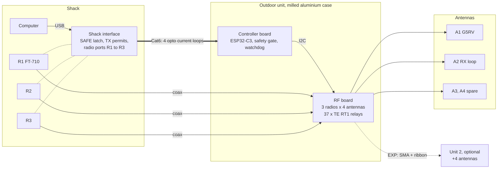
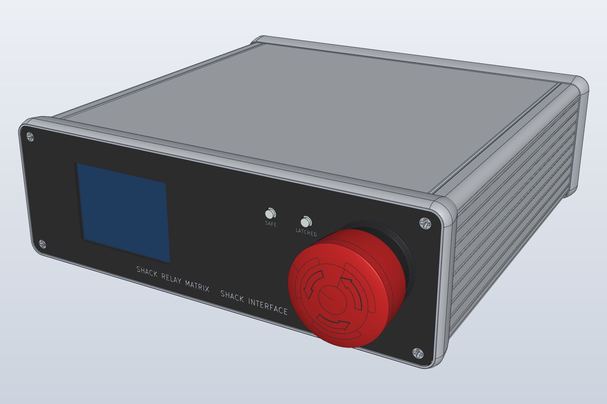
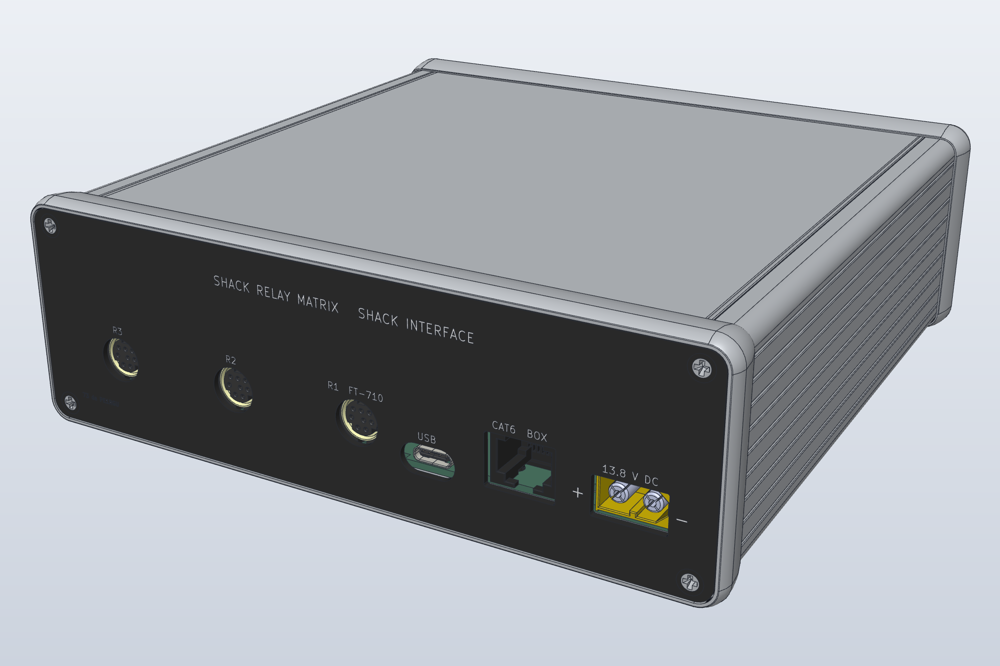

# HF Antenna Switch


**A remote antenna switch for an HF amateur radio station: 3 radios, 4 antennas, one Cat6 cable, and the safety rules in hardware.**
**Designed by a radio amateur together with an AI assistant, and documented decision by decision.**

<p align="center">
  
  
</p>
<p align="center"><em>Left: the outdoor unit, lid removed. Right: the shack interface, cover removed. CAD views of the current design, not photos.</em></p>

The relay unit sits outdoors, close to the antennas, in a milled aluminium case.
A small interface box in the shack controls it over one Cat6 cable.
A computer sends the commands over USB.
If anything goes wrong (a cable break, a box fault, a press on the KILL switch), every radio is inhibited and every relay is released, without help from the firmware.

> **Status: design phase.** Schematics, layouts and the case are drawn and checked by scripts. No board is built yet, and nothing here is tested on the bench.

## In numbers

| | |
|---|---|
| Radios | 3, each with its own transmit antenna and receive antenna |
| Antennas | 4 per unit; a second unit adds 4 more |
| Frequency range | 1.8 to 54 MHz |
| Power | 100 W, SWR up to 3:1 |
| Relays | 37 × TE RT1, one type everywhere |
| RF board | 6 layers, 50 Ω coplanar lines |
| Link to the shack | One Cat6 cable, four opto-isolated current loops |
| Outdoor case | Milled aluminium tray, 288 × 250 × 66 mm |
| Shack case | Hammond 1455T1601 extrusion, PCB end plates |
| Controllers | ESP32-C3 in the box and in the shack |

## Why this project may interest you

**Safety in hardware, not only in software.**
A receive-only antenna (such as a loop with a preamplifier) never sees transmit power.
No relay switches while RF is present.
The firmware may ask for a state. The hardware decides whether that state is allowed.

**Designed with an AI, in the open.**
This is an experiment in how a person and an AI assistant (Claude, by Anthropic) design hardware together.
I set the goals and took the decisions. The AI did much of the research, the calculations and the scripts.
The [design log](design-log.md) records every decision, who took it, and why. Rejected options stay in it too.
See [docs/how-this-was-made.md](docs/how-this-was-made.md) for the method and its limits.

**Everything comes from scripts.**
Schematics, footprints, board placement, routing, end plates, the 3D fit checks and these renders are all generated by Python scripts.
A change is repeatable, and two revisions can be compared.
The logic is checked with truth tables against the real netlists.
[tools/README.md](tools/README.md) lists every script and how to run it.

## What it does

- Connects each of 3 radios to a transmit antenna and, separately, to a receive antenna.
- Keeps receive-only antennas away from transmit power.
- Changes relays only when no RF is present (TX inhibit and handshake per radio).
- Stops all transmission and releases all relays on any fault, cable break or KILL switch.
- Grounds antennas that are not in use, through a static bleed.
- Feeds an active receive antenna through a switched bias-T.
- Is controlled from a computer over USB through the shack interface.

## System overview



The dotted lines from the radios are the TUNER and LINEAR jacks (TX inhibit, PTT sense).
More detail, and the reason for each choice, is in [docs/architecture.md](docs/architecture.md).

## The outdoor unit

The RF board carries the relay matrix: per radio a changeover relay, a transmit row and a receive row; per antenna a ground relay, a static bleed, an RF detector and an optional bias-T.
The controller board sits on standoffs above it.

<p align="center">
  
</p>
<p align="center"><em>Controller board (KiCad render). Left: the Cat6 link with the opto current loops and a 3 mm isolation gap. Right: the ESP32-C3 DevKit. The NOR gate on the silkscreen is the relay enable: RLY_EN = NOR(KILL, MCU_EN_N, FAULT).</em></p>

## The shack interface

The shack interface powers the four current loops, holds the SAFE latch and the transmit permits, and connects to the three radios.
At the front: a 2 inch colour display, the SAFE and LATCHED LEDs, RESET and the KILL switch.
At the rear: 13.8 V DC, Cat6 to the outdoor unit, USB and the three radio ports.

<p align="center">
  
  
</p>
<p align="center"><em>Front and rear of the shack interface (SolidCraft views).</em></p>

## Safety chain

The SAFE loop is one series current loop from the shack to the box and back.
Any break stops the current: KILL switch, cable cut, box fault, or loss of power.
All radios are then inhibited and all relays released, in hardware, without help from the firmware.

<p align="center">
  
</p>

Radios R2 and R3 transmit only after a handshake with the box: request, state check, relay set, read-back, permit.

<p align="center">
  
</p>

All logic, timing and flow diagrams:

| Diagram | Content |
|---|---|
| [L1](hardware/docs/diagrams/L1_safe_loop.svg) | SAFE loop |
| [L2](hardware/docs/diagrams/L2_box_safety_gate.svg) | Box safety gate |
| [L3](hardware/docs/diagrams/L3_shack_latch_port.svg) | Shack latch and radio port |
| [T1](hardware/docs/diagrams/T1_box_startup.svg) | Box start-up timing |
| [T2](hardware/docs/diagrams/T2_safe_stop.svg) | SAFE stop timing |
| [T3a](hardware/docs/diagrams/T3a_tx_start.svg), [T3b](hardware/docs/diagrams/T3b_tx_end.svg) | TX start and TX end timing |
| [T4](hardware/docs/diagrams/T4_ptt_r1.svg) | R1 PTT loop timing |
| [F1](hardware/docs/diagrams/F1_box_firmware.svg) | Box firmware flow |
| [F2](hardware/docs/diagrams/F2_tx_handshake.svg) | TX handshake for R2 and R3 |

## Where it stands

| Part | State |
|---|---|
| Requirements and architecture | Requirements in draft, architecture rev C |
| Schematics, all boards | Generated, ERC clean, logic checked by script |
| RF board layout | Placed and routed, DRC clean |
| Controller board layout | Placed and routed, DRC clean |
| Shack interface layout | Placed and routed, DRC clean; end plates drawn |
| Cases | Outdoor tray and shack end plates drawn; 3D fit checked |
| Firmware | Not started |
| Bench tests | Not started; see [docs/test/test-spec.md](docs/test/test-spec.md) |

The [CHANGELOG](CHANGELOG.md) has the details per revision.

## Documents

| Document | Content |
|---|---|
| [docs/requirements.md](docs/requirements.md) | What we build and what is important |
| [docs/architecture.md](docs/architecture.md) | System blocks, interfaces, main decisions |
| [docs/design/](docs/design/) | Detailed design, one document per board |
| [docs/test/test-spec.md](docs/test/test-spec.md) | How each requirement is tested |
| [design-log.md](design-log.md) | Every decision, assumption, calculation, standard and measurement, with its reason |
| [CHANGELOG.md](CHANGELOG.md) | Changes per revision |

## Repository layout

```
docs/                       requirements, architecture, design, test, images
hardware/unit/              outdoor unit: RF board, controller board, case, verification scripts
hardware/shack-interface/   shack interface board, end plates, case fit and renders
hardware/docs/diagrams/     logic, timing and flow diagrams
firmware/                   box and shack firmware (not started)
tools/README.md             where each generator and verification script is, and how to run it
Datasheets/                 datasheet register (the PDFs are not in the repository)
archive/                    earlier revisions (card cage and backplane, rev A/B)
```

## Tools

- KiCad 10, with the board layouts generated by Python scripts
- Python 3 for the generators, the router and the verification scripts
- cadquery and SolidCraft for the cases, the 3D fit checks and the renders
- JLCPCB for the PCBs

## Licence

- Hardware design files and documentation: CERN Open Hardware Licence v2, Strongly Reciprocal (CERN-OHL-S-2.0). See [LICENSE](LICENSE).
- Python scripts (generators, verification): MIT. See [LICENSE-MIT](LICENSE-MIT).
- Vendor 3D models and libraries (SnapEDA, SamacSys, Ultra Librarian, Amass, Amphenol) are not in the repository. See [hardware/THIRD-PARTY.md](hardware/THIRD-PARTY.md) for where to get them.

Source Location (required by CERN-OHL-S): https://github.com/PE1RGU/hf-antenna-switch

73 de PE1RGU
