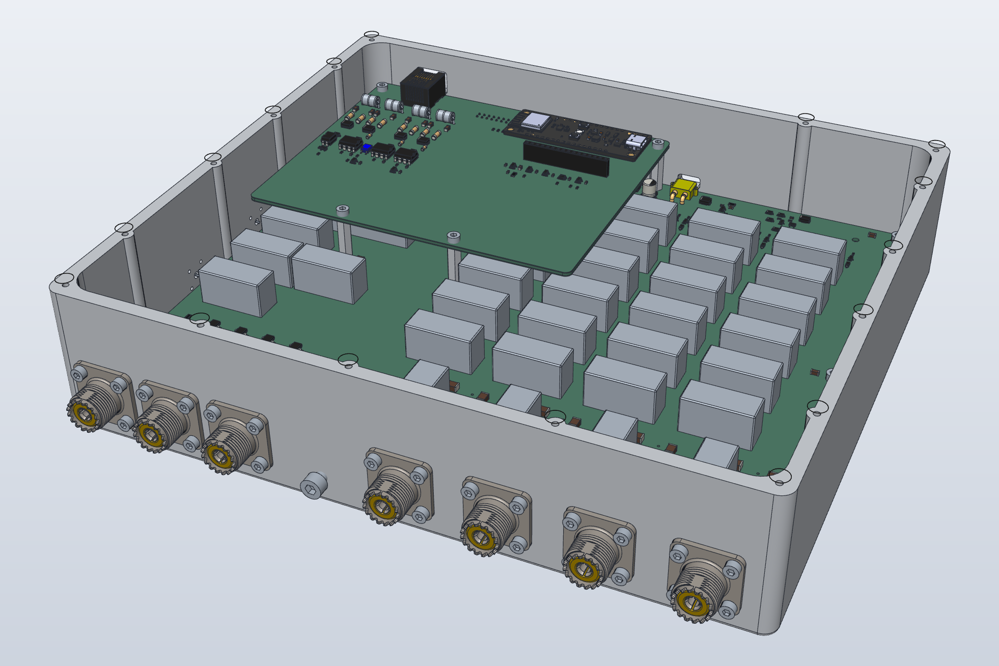
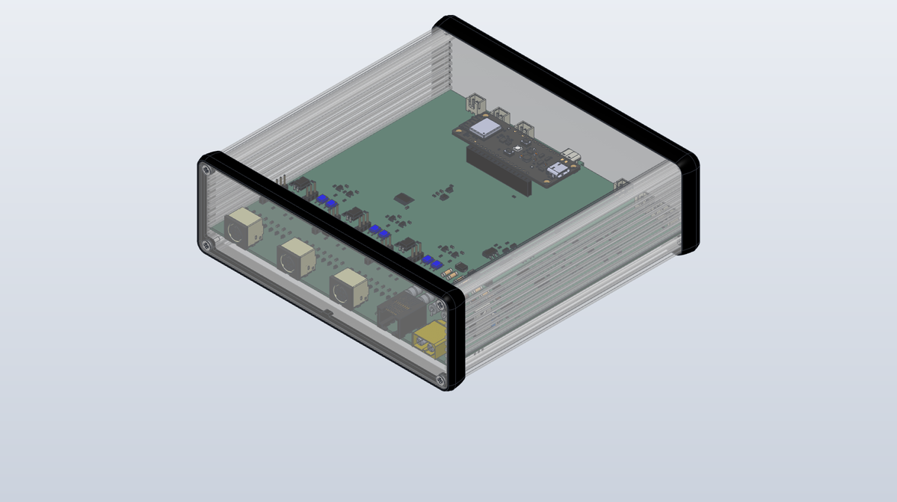
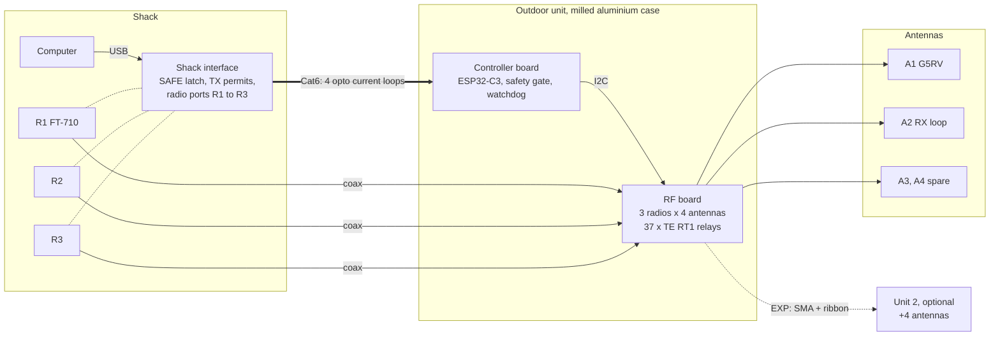
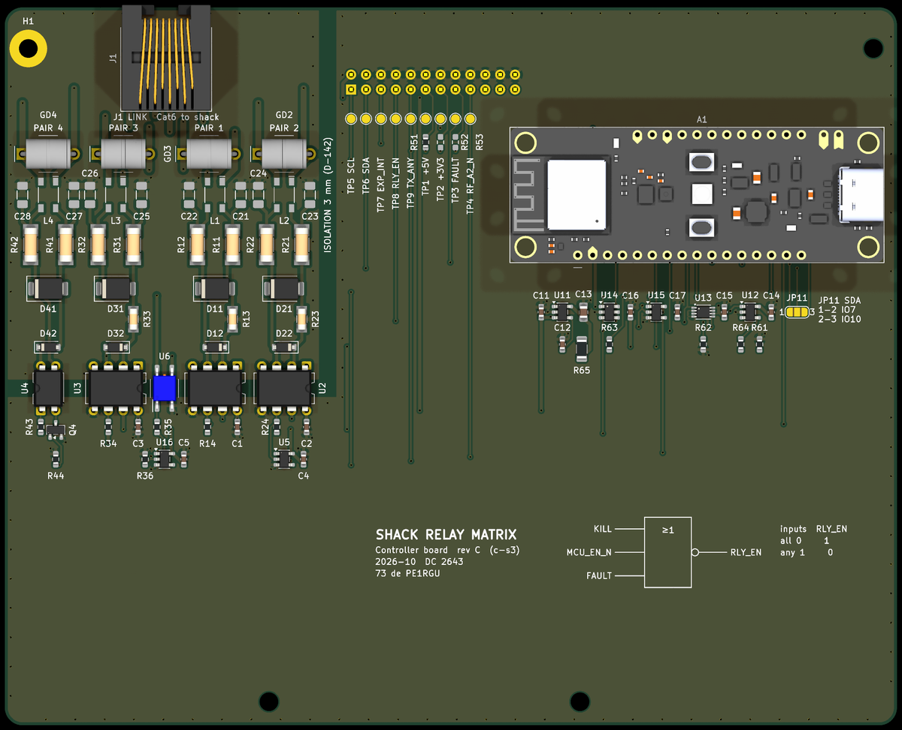
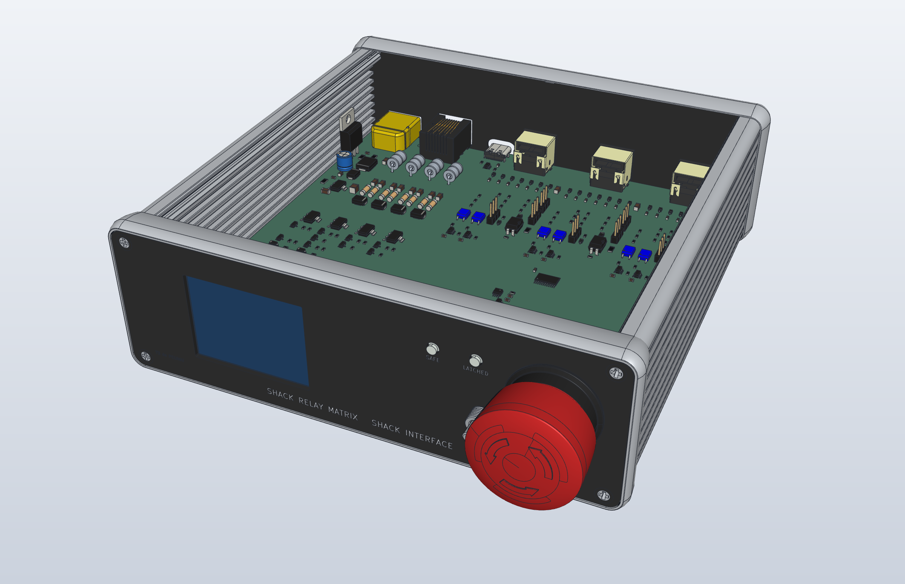

# HF Antenna Switch


A remote antenna switch for an amateur radio station.
It connects up to 3 HF radios to 4 antennas, with a path to 8 antennas.
The relay unit sits outdoors in a milled aluminium case. A small interface box in the shack controls it.

<p align="center">
  
  
</p>
<p align="center"><em>Left: the outdoor unit, RF board with the controller board stacked above. Right: the shack interface. CAD renders, not photos.</em></p>

Status: design phase. Schematics are drawn and checked. No board is built yet. Nothing here is tested on the bench.

## About this project: designed with AI

This project has two goals.

1. Build a safe and useful antenna switch for my own station.
2. Find out how hardware design works when a person and an AI work on it together.

The second goal is the main reason the project exists.

The design is a joint effort between me (PE1RGU) and an AI assistant, Claude by Anthropic.
I set the goals and the requirements. I took the decisions, often after the AI proposed and compared options.
The AI did much of the research, the calculations, the schematic generation scripts and the verification scripts.
Many ideas in this design came from the AI, and many were changed or rejected after discussion.
For that reason I do not claim this design as only my own work.

What this means for you as a reader:

- Values and calculations are checked by scripts and by review, but not all of them on the bench yet.
- The design log records who decided what, and why.
- See [docs/how-this-was-made.md](docs/how-this-was-made.md) for the method.

## What it does

- Connects each of 3 radios to a transmit antenna and, separately, to a receive antenna.
- Keeps receive-only antennas (such as a loop on ground) away from transmit power.
- Changes relays only when no RF is present (TX inhibit and handshake per radio).
- Stops all transmission and releases all relays on any fault, cable break or KILL switch.
- Grounds antennas that are not in use, through a static bleed.
- Feeds an active receive antenna through a switched bias-T.
- Is controlled from a computer over USB through the shack interface.

## System overview



The dotted lines from the radios are the TUNER and LINEAR jacks (TX inhibit, PTT sense).
More detail, and the reason for each choice, is in [docs/architecture.md](docs/architecture.md).

## Inside the outdoor unit

<p align="center">
  
</p>
<p align="center"><em>Controller board, rev C (KiCad render). Left: the Cat6 link with the opto current loops and a 3 mm isolation gap. Right: the ESP32-C3 DevKit. The NOR gate on the silkscreen is the relay enable: RLY_EN = NOR(KILL, MCU_EN_N, FAULT).</em></p>

## Inside the shack interface

<p align="center">
  
</p>
<p align="center"><em>Shack interface, cover removed (SolidCraft view, board p8b, front plate a8; made with hardware/shack-interface/case/render-full/open-cover.json). At the rear: 13.8 V DC, Cat6 to the outdoor unit, USB and the three radio ports. At the front: the 2 inch display, the SAFE and LATCHED LEDs, RESET and the KILL switch.</em></p>

## Safety chain

The SAFE loop is one series current loop from the shack to the box and back.
Any break stops the current: KILL switch, cable cut, box fault, or loss of power.
All radios are then inhibited and all relays released, in hardware, without help from the firmware.

<p align="center">
  
</p>

Radios R2 and R3 transmit only after a handshake with the box: request, state check, relay set, read-back, permit.

<p align="center">
  
</p>

All logic, timing and flow diagrams:

| Diagram | Content |
|---|---|
| [L1](hardware/docs/diagrams/L1_safe_loop.svg) | SAFE loop |
| [L2](hardware/docs/diagrams/L2_box_safety_gate.svg) | Box safety gate |
| [L3](hardware/docs/diagrams/L3_shack_latch_port.svg) | Shack latch and radio port |
| [T1](hardware/docs/diagrams/T1_box_startup.svg) | Box start-up timing |
| [T2](hardware/docs/diagrams/T2_safe_stop.svg) | SAFE stop timing |
| [T3a](hardware/docs/diagrams/T3a_tx_start.svg), [T3b](hardware/docs/diagrams/T3b_tx_end.svg) | TX start and TX end timing |
| [T4](hardware/docs/diagrams/T4_ptt_r1.svg) | R1 PTT loop timing |
| [F1](hardware/docs/diagrams/F1_box_firmware.svg) | Box firmware flow |
| [F2](hardware/docs/diagrams/F2_tx_handshake.svg) | TX handshake for R2 and R3 |

## Documents

| Document | Content |
|---|---|
| [docs/requirements.md](docs/requirements.md) | What we build and what is important |
| [docs/architecture.md](docs/architecture.md) | System blocks, interfaces, main decisions |
| [docs/design/](docs/design/) | Detailed design, one document per board |
| [docs/test/test-spec.md](docs/test/test-spec.md) | How each requirement is tested |
| [design-log.md](design-log.md) | Every decision, assumption, calculation, standard and measurement, with its reason |
| [CHANGELOG.md](CHANGELOG.md) | Changes per revision |

## Repository layout

```
docs/                 requirements, architecture, design, test
hardware/unit/        outdoor unit: RF board, controller board, case, verification scripts
hardware/shack-interface/   shack interface board
hardware/docs/diagrams/     logic, timing and flow diagrams
firmware/             box and shack firmware (not started)
tools/README.md       where each generator and verification script is, and how to run it
Datasheets/           datasheet register (PDFs are not in the repository)
archive/              earlier revisions (card cage and backplane, rev A/B)
```

## Tools

- KiCad 10
- Python 3 for the schematic generators and the verification scripts
- JLCPCB for the PCBs

## Licence

- Hardware design files and documentation: CERN Open Hardware Licence v2, Strongly Reciprocal (CERN-OHL-S-2.0). See [LICENSE](LICENSE).
- Python scripts (schematic generators, verification): MIT. See [LICENSE-MIT](LICENSE-MIT).
- Vendor 3D models and libraries (SnapEDA, SamacSys, Ultra Librarian, Amass, Amphenol) are not in the repository. See [hardware/THIRD-PARTY.md](hardware/THIRD-PARTY.md) for where to get them.

Source Location (required by CERN-OHL-S): https://github.com/PE1RGU/hf-antenna-switch

73 de PE1RGU
