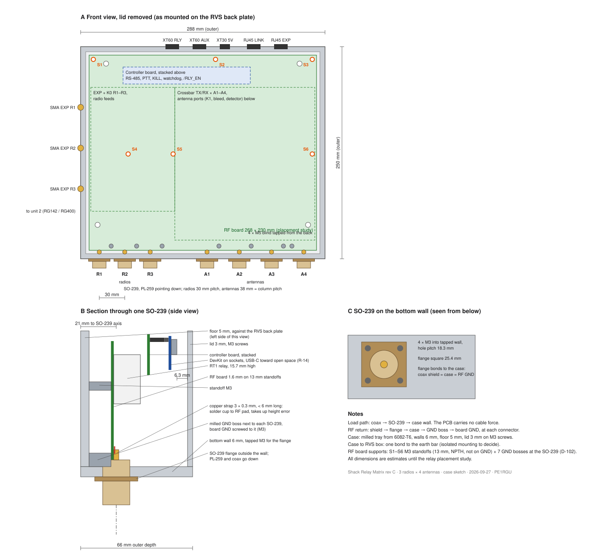

# Case

Status: draft, 2026-10-07. Drawn from design-log.md and the case sketch. The case is not drawn in CAD yet; dimensions are design values until the CNC drawing.

Sketch: hardware/unit/unit-case-sketch.svg (generator gen_case_sketch.py).

*Case sketch: front view, SO-239 section, SO-239 from below (gen_case_sketch.py)*

## 1. Function and interfaces

- Custom milled tray from 6082-T6 (D-02). Outer 288 W × 250 H × 66 D mm (D-98, was 60). Walls 6 mm, floor 5 mm; lid 3 mm on M3 screws.
- The case mounts flat on the RVS box back plate: 4 × M5 blind tapped from the back of the floor. The top pair sits at case x 30 and 258, clear of S1 and S3 (D-102).
- Bottom wall: radio SO-239 R1 to R3 at 30 mm pitch (left), antenna SO-239 A1 to A4 at 38 mm pitch (right, under the columns). Left wall: 3 SMA EXP, one per radio block: bulkhead jack with a 4-hole flange, strap to the board edge (D-108). Top wall: XT60 +12V RLY, XT60 +12V AUX, XT30 +5V, RJ45 LINK, EXP ribbon passage (D-53).
- Load path: coax → SO-239 → case wall. The PCB carries no cable force.
- RF return: shield → flange → case → GND boss → board GND, at each connector. Coax shield = case = RF GND.
- The case bonds to the RVS earth bar at one point only.
- Mounting (Prins, 2026-10-24): isolated from the RVS back plate, because the back plate is bonded to earth. 4 × M5 A4 from behind the plate, insulating shoulder bushing in the plate hole, insulating spacer 5 mm between plate and tray. Spacer (with a spigot into the plate hole Ø 10) and the washer under the bolt head are 3D printed (Prins, 2026-10-24); model bodies Spacer and Insulating washer, parameters sp_t, sp_d, wsh_t, wsh_d, plate_t (3 mm, confirmed by Prins 2026-10-24), plate_hole, bolt_bore. One short, wide tinned-copper braid from the case to the earth bar is the only bond. Isolation also avoids the aluminium / stainless galvanic couple.

## 2. Circuit description

The case has no circuit. Its electrical functions:

- RF return and shield: coax shield → SO-239 flange → case wall → milled GND boss → board GND, at each connector (D-10, D-105).
- One bond from the case to the RVS earth bar. Isolated or direct mounting on the back plate is still open.
- The plated CHASSIS lug on the controller board takes the GDT surge path to the box earth (D-57).

## 3. Component selection and derating

| Item | Choice | Reason | Status |
|---|---|---|---|
| Material | Aluminium 6082-T6, milled tray and lid (D-02) | Free board size; SO-239 in the wall; cable force into the case | decided |
| Walls, floor, lid | 6, 5 and 3 mm | 6 mm wall takes the 83-798 without a pocket and the M3 threads of the flange | decided |
| Depth | 66 mm outside, 58 mm inside (D-98) | DevKit on sockets needs about 52 mm (C-27) | decided |
| SO-239 | Amphenol RF 83-798, 4 × M3 into the wall (D-10) | PTFE insulator; flange bonds to the case | decided |
| Board supports | Six milled bosses Ø 8 × 13 mm to the board underside, M3 tapped 8 mm, no separate standoff (Prins, 2026-10-25; was 10 mm F-M on 3 mm pads); plated holes on CHASSIS with a bond option each (D-102, D-132); plus 10 GND bosses (7 SO-239, 3 SMA) | Relay mass; RF bond at the bosses (D-18); support bonds set on the bench | decided |
| Mounting | 4 × M5 blind tapped from the back, 8 mm deep, into inside pads Ø 16 × 5 mm; at case (x, y) (30, 20), (258, 20), (30, 215), (258, 215) | Isolated from the earthed back plate; floor 5 mm alone gives too little thread | decided (2026-10-24) |
| Surface finish | Chromate-free conductive conversion coating, MIL-DTL-5541 Type II Class 3, tray, lid and EXP plate | Keeps the RF bond at flanges, bosses, lid rim and earth face without masking; the RVS box is the weather barrier. Engraving may be paint-filled for contrast | decided (Prins, 2026-10-24) |

## 4. Calculations

- C-27: height stack. Standoff 13, RF board 1.6, RT1 15.7, gap 4, controller board 1.6, DevKit on sockets 11.05 + 1.6 + USB-C 3.3: DevKit top at 51.85 mm; with the 58 mm inner height about 6.2 mm free.
- C-29: first resonance of the RF board on its supports, about 135 Hz with D-102 against 38 Hz with 4 corners (simply supported panel, for comparison only).
- C-12: board 268 × 230 mm gives the case about 288 × 250 mm outside.

## 5. Layout rules

SO-239 mounting (Amphenol RF 83-798, D-10):

- In the 6 mm bottom wall: flange outside, 4 × M3 tapped into the wall on an 18.24 mm square (flange holes 3.18 mm); wall hole 16.7 mm for the 15.75 mm rear body. No wall pocket needed.
- From the drawing (estimated from scale, A-05): rear body about 4 mm behind the flange, solder cup tip about 9.6 mm behind the flange, so the cup reaches about 3.6 mm into the case.
- Board bottom edge 5 mm from the inner bottom wall (D-15), so the cup-to-pad gap stays about 1.5 mm and the strap stays under 6 mm. Solder-cup opening towards the board. Board edge 4 mm from the inner left and right walls and 3 mm from the inner top wall (inner 276 × 238 mm, board 268 × 230 mm; the 10 mm of C-12 is measured to the outer face). The sketch still shows 10 mm at the bottom edge.
- EXP SMA (Amphenol RF 901-9215, second source Cinch/Johnson 142-0701-631 (D-174), alternative 132142, D-110): pocket 13 × 13 × 2 mm milled from the outside, wall 4 mm there, flange in the pocket on 4 × M2 tapped into the wall (holes 2.60 mm on 8.64 mm). The contact ends about 1.1 mm past the inner wall; strap 3 × 0.3 mm to the land at the board edge. Axis about 1.5 mm above the board top surface. Milled GND boss with M3 beside each SMA.
- SO-239 axis 16 mm from the inner floor. Copper strap 3 × 0.3 mm from cup to pad. Milled GND boss with M3 next to each SO-239.

Height stack (build values, C-27): standoff 13, RF board 1.6, standoff 20 to the controller board (RT1 15.7 high, 4.3 mm free above it), controller board 1.6, DevKit on sockets (11.05 + 1.6 + USB-C 3.3). DevKit top at 52.15 mm, lid inside at 58 mm, 5.85 mm free (C-27, D-98, D-140). Checked in 3D with both boards (M-52 to M-54). DevKit USB end toward open space, 40 mm corridor (R-14).

RF board supports (D-102, C-29, M-32): six M3 standoffs, 13 mm, plated holes on CHASSIS with a bond option footprint each (D-132), 8 mm keep-out. Board coordinates in mm from the top left:

| Support | x | y | Place |
|---|---|---|---|
| S1 | 5 | 5 | top left corner |
| S2 | 149 | 5 | between XT60 AUX and XT30 |
| S3 | 263 | 5 | top right corner |
| S4 | 46 | 116.5 | between the EXP RX R2 relay and the K0 R2 NC line |
| S5 | 99 | 116.5 | channel between the feed bands and the A1 relays |
| S6 | 263 | 116.5 | right of the A4 column |

Plus the seven M3 screws to the SO-239 GND bosses at y 225, 14 mm beside each SO-239 (the RF bond). A true 3 × 3 grid does not fit: there is no free spot in the relay field near the centre. First resonance about 135 Hz, against 38 Hz with 4 corners (C-29, simply supported panel, for comparison only).

Board corners R 5 mm (D-113): the pocket inner corner radius may be up to about 15 mm.

Rules the PCB follows for the case: cable forces go into the case, not the PCB. Outline at a fixed offset from the inner walls with a keep-out band. Mounting grid shared with the case drawing.

3D: no 83-798 STEP is available; the 83-1R STEP (hardware/unit/unit.3dshapes/AmphenolRF_83-1R.step, same flange and thread) is the placeholder. Not in the repository: see hardware/THIRD-PARTY.md.

## 6. Verification done

- M-32: support positions checked against the placement study (clearance to relays, RF bands and connectors beyond the 8 mm keep-out: 0.5 to 30 mm, all positive).
- First CAD model in SolidCraft (2026-10-23): hardware/unit/case/rf-case.solidcraft, STEP export rf-case.step, views rf-case-*.png. Parametric (W, H, D, wall, floor_t, lid_t, Ri, so_z, standoff and others). Contains tray, lid plate, 7 SO-239 cutouts with 4 x M3, 7 GND bosses with rib and M3, 6 standoff M3 in the floor, 4 M5 mounting pads with blind M5 from the back, 3 EXP SMA pockets with 4 x M2. Outer vertical corners R 6 (Ro), back edge of the tray and top edge of the lid R 2 (Re); the tray-to-lid joint stays sharp. RF board 268 x 230 x 1.6 as a reference body: no interference with the tray. All wall openings are in the model.

## 7. Open items

- Earth strap: M5 tapped through the wall and the boss, 16 mm (earth_depth = wall + 10 mm; through-tapped, Prins 2026-10-25; was blind 13 mm, where the M5 × 16 bottomed out before it clamped the lug) (M5 × 16, same as the mounting bolts) in the bottom wall (the SO-239 side, Prins 2026-10-24), case x 115.5 between R3 and A1, 7 mm above the inner floor, with an inside boss 10 × 9 × 11 mm (2026-10-24).
- Lid: 16 × M3 countersunk ISO 10642, A2, M3 × 10 (Prins, 2026-10-24), tapped 8 mm into the tray. 4 corners at 6 mm from both outer faces (in the solid corner). 12 side screws at 4.5 mm from the outer face (screw_in), each on a full-height lug Ø 7 (lug_d) from the inner floor to the wall top, so the tray mills from the top without an undercut. Positions (case x from left, world y from the bottom wall): bottom wall x 67, 128, 206 (between the SO-239s and their flange screws); top wall x 224 only; left and right walls y 45, 107.5, 155.5, 210 (clear of the EXP SMA pockets). The top wall takes one side screw only: the controller board edge is 1 mm from the top wall over case x 11 to 163, and the RJ45, XT60 and XT30 sit there. Lugs reach 8 mm from the outer face: clearance to the RF board edge 3 mm (bottom), 2 mm (left, right); to the controller board edge 3 mm (left). Lid holes 3.4 mm with a 90° countersink Ø 6.9 (csk_d), modelled as extrude cuts on the lid (the hole tool put the corner countersinks into the tray). No seal.
- RF board supports (Prins, 2026-10-25): milled bosses Ø 8 (so_pad_d, inside the 8 mm keep-out) × 13 mm (so_pad_h = standoff) under S1 to S6, M3 tapped 8 mm. The 10 mm F-M standoffs are removed. S3 and S6: M3 × 6 into the boss. S1, S2, S4, S5: the 20 mm M-F controller standoff stud goes through the board into the boss.
- GND bosses (Prins, 2026-10-25): free-standing Ø 10 × 13 mm, no rib to the wall, so the flange screw holes can be tapped through (a rib blocked the lower flange hole on the boss side of each connector). Gap to the inner wall 5 mm at the SO-239s, 3 mm at the SMAs.
- SMA GND bosses (2026-10-25): 3 bosses under the RF board GND holes J4, J5, J6 (board x 4, y 52.5, 100.5, 148.5; case world x 14, y 188.5, 140.5, 92.5), M3 tapped 8 mm. Missing in the first JLC order file.
- Through-tapped flange holes (Prins, 2026-10-25): SO-239 4 × M3 per connector through the 6 mm wall (depth wall + 1 mm), SMA 4 × M2 through the 4 mm wall behind the pocket (depth wall - 1 mm from the pocket floor). Easier to machine, tap and check than blind holes.
- H1 (CHASSIS, JP1 to GND) on the RF board is not used (Prins, 2026-10-25): board GND bonds to the case at the 10 GND bosses, so no stud under H1. H1 sits 2.2 mm off the top-right M5 mounting bolt axis, on its pad.
- Screw set (Prins, 2026-10-24), 4 types: (1) M3 × 6 button or cheese head A2: SO-239 flanges 28, RF board to GND bosses 10, RF board to support bosses S3 and S6 2, controller board to the 20 mm standoffs 4, EXP plate 2 (46, 2026-10-25); (2) M3 × 10 countersunk ISO 10642 A2: lid 16; (3) M5 × 16 hex socket ISO 4762 A4: back-plate mounting 4, earth strap 1; (4) M2 × 4 cheese head A2: EXP SMA flanges 12. Standoffs: 4 × 20 mm M-F to the controller board only (the RF board sits on milled bosses, 2026-10-25).
- Top wall cutouts (2026-10-24), from the KiCad 3D models placed in the case frame (STEP export, user origin 20 × 20 mm): XT60 J11 and J12 16.5 × 9.4 mm (xt60_w, xt60_h) at case x 109.6 and 139.6, centre 23.8 mm above the case back (body 15.5 × 8.4 on the RF board top); XT30 J13 11 × 6 mm at case x 172.5, centre 22.1 (front width about 9.9, confirmed by Prins 2026-10-24); RJ45 J1 (Wurth 615008137121, controller board) 16.2 × 11.8 mm at case x 38.5, from 41.6 to 53.4 mm above the case back: housing 15.15 wide and 11.65 above the board top (41.12), so the opening starts 0.5 mm above the board and the PCB edge stays hidden (Prins, 2026-10-24; was 16.7 high and showed the board). Corners R 1.5 (cut_r). EXP ribbon passage (Prins, 2026-10-24, option A): slot 37 × 9 mm (slot_w, slot_h) at case x 74, centre 30 mm above the case back, between the RF board top and the controller board; it passes a crimped 2 × 12 IDC socket. Covered by a 49 × 21 × 2 mm aluminium plate (body EXP plate) on 2 × M3 × 6 at x 74 ± 21.5 (M3 tapped 5 mm): blank on unit 1, ribbon clamp and shield contact on unit 2.
- EXP SMA wall hole (2026-10-24): Ø 3.0 mm (sma_hole). Behind the 901-9215 flange only the Ø 1.27 contact passes the 4 mm wall, so the hole is a short air line: 60 ln(3.0/1.27) ≈ 52 Ω.
- Clash check (2026-10-24, offline, OpenCascade on the STEP files): tray and lid against the RF board (J*, K* models) and the controller board (J*, A* models): no overlap. Closest: RJ45 front 0.55 mm from the inner top wall; controller board corner 0.68 mm from the top-left pocket corner; A4 relay 2.4 mm.
- Top lid edge (Prins, 2026-10-24): kept as it is, one side screw at x 224; no notch in the controller board (c-s5 stays order-ready). About 218 mm without a screw from the top-left corner.
- Fit check with the full boards (2026-10-24): RF board and controller board exported from KiCad 10 (kicad-cli pcb export step --user-origin 20x20mm, all 3D models) to hardware/unit/case/ref-rf-board.step and ref-controller-board.step, imported in rf-case.solidcraft as 'RF board 3D' (placement x + 10, y + 241, z + 18; the RF export carries the controller board through its CTL3D model, so the separate controller import was removed). Offline OpenCascade check of tray, lid and EXP plate against all 1080 board solids: no overlap. Closest: RJ45 0.64 mm from the inner top wall, controller board corner 0.68 mm from the top-left pocket corner, A4 relay 2.4 mm. Note: CTL3D uses unit.3dshapes/controller-board.step of 2026-10-22; refresh it from the c-s5 layout before the next fit check.
- Printed spacer material and torque: plastic creeps under bolt preload. Use 100 % infill, PETG or ASA (better PA-CF), low torque and a spring washer; check the bolts after the first summer.
- Insulating spacer and bushing parts to select.
- CNC order: JLCCNC W2026102506308334 (submitted 2026-10-25, review before payment) carries the first tray file, without the SMA GND bosses, the support bosses and the through-tapped holes. Cancel and resubmit with the new tray STEP and drawing.
- 3D model fixes (2026-10-25): the seven 83-1R SO-239 imports had the threaded barrel inside the case (A4 was also rotated and placed below the floor); all screw stand-ins were reversed (head on the shank side). Fixed: barrel outward, flange back face on the outer wall face; every screw head on its driving side.
- SMA 3D model (2026-10-25): the simple 901-9215 stand-ins are replaced by the vendor STEP of the Cinch/Johnson 142-0701-631 (hardware/unit/case/ref-sma-142-0701-631.step), imported 3 times: flange back face on the pocket floor, pin outward-in. Its interface matches the case as drawn: flange 12.7 square, 1.57 thick, holes Ø2.59 on 8.64, rear only the Ø1.27 pin, 5.21 long, so it ends 1.2 mm past the inner wall (901-9215: about 1.1). Offline check: no overlap with the tray (face contact on the pocket floor only). The Amphenol 132166 model (also downloaded) does not fit as drawn: its rear tab is only 2.54 long and ends inside the 4 mm wall. Main part stays 901-9215 (D-110); 142-0701-631 is the second source and the 3D model (Prins, 2026-10-25, D-174).
- 83-798 rear length on a real part (A-05, M-03).
- S2, S4 and S5 positions against the logic and coil-driver parts at the layout (M-32); S5 has 0.5 mm between its keep-out and the band edges.
- Lid sealing: not needed (Prins, 2026-10-24); the RVS box is the weather barrier.
- 3D check of the stack: done for both boards and the inner case box (M-52 to M-54); repeat with the case CAD model.
- CAD working method (2026-10-25): a full rebuild of rf-case.solidcraft took over an hour in the app. Cause: the lid text Emboss1 (about 72 % of the rebuild, feature 104 of 470, so every edit before it rebuilt it) and the board import 'RF board 3D' (575 rigid joints). Both are now suppressed in the working file; full rebuild about 4 to 5 minutes. Rules: keep Emboss1 and the board import suppressed while editing; switch Emboss1 on once before a lid export; fit checks against the board STEP offline (OpenCascade). For several edits, roll the timeline marker back before the first changed feature, make the edits, then roll to the end: one rebuild. Hole depths through parameters so_tap, sma_tap, boss_tap, earth_depth. Backup of the heavy file: hardware/unit/case/rf-case_pre-light.solidcraft.
- Drawing RF-CASE-01 rev B (2026-10-25, gen_case_drawing.py): 94 features, 79 of 79 tapped holes match the model thread data (4 lid-screw tags and the S2 tag sit on the adjacent body in the model; the tray geometry was checked offline). rf-case.step = tray of 2026-10-25 + lid and EXP plate of 2026-10-25 00:03 (unchanged).
