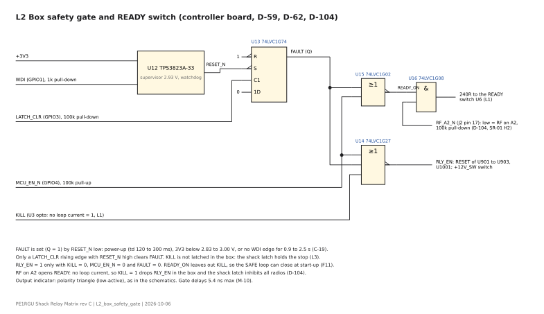
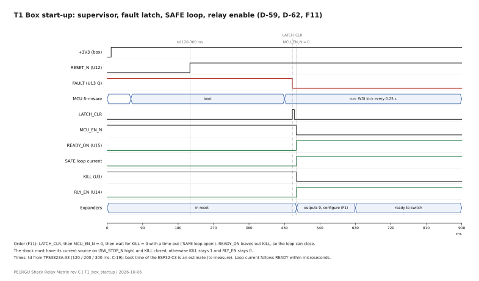
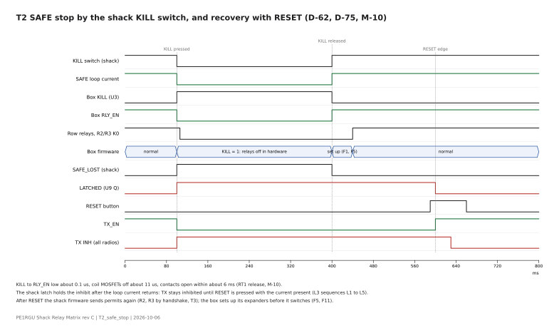
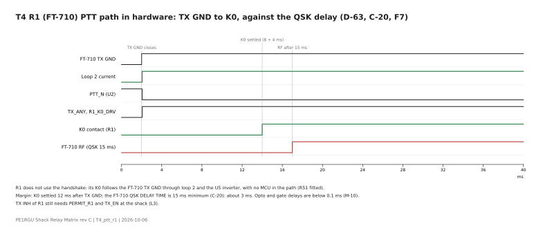
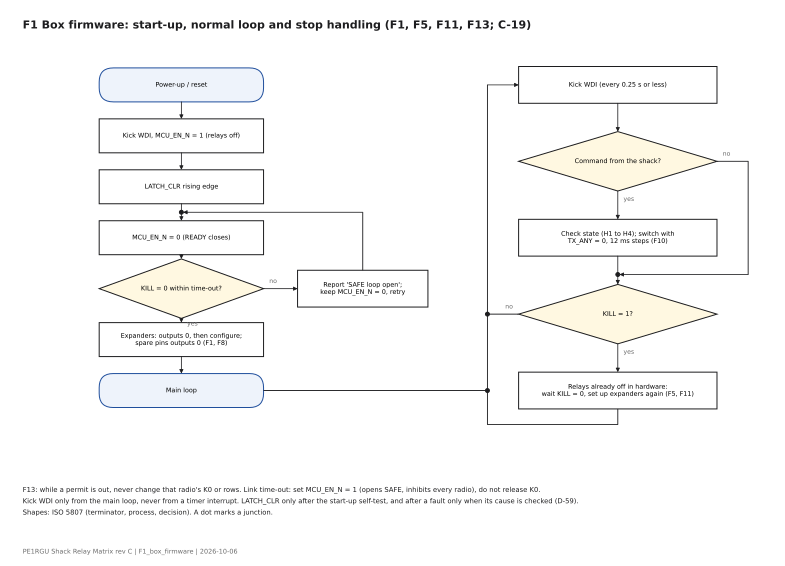

# Controller board

Status: draft, 2026-10-07. Drawn from design-log.md and the schematic hardware/unit/controller-board/ (generator c11-tp-bus). No board is built yet.

## 1. Function and interfaces

Unit 1 only. The board sits above the RF board on standoffs and the J14 header (D-51). Unit 2 has no controller: the unit 1 controller board runs it over the EXP ribbon (D-05, D-53). One controller, one watchdog, one safety chain.

- MCU: ESP32-C3-DevKit-RUST on gold sockets (D-55, D-95). Fed on its 3V3 pin from an LP2985-33 LDO; the on-board buck is held off (ENABLE low); Wi-Fi and BLE off.
- RJ45 LINK (Cat6 #1 to the shack). Four opto current loops, powered from the shack (D-56): pair 1 data shack to box, pair 2 PTT, pair 3 SAFE (D-62), pair 4 data box to shack. UART 9600 baud (D-58).
- J2 to the RF board J14 (pin-out in rf-board.md).
- EXP header for unit 2 (D-53): 2 × 12 IDC ribbon with the J14 pin-out, single-ended, 0.5 m max inside the RVS box. Driven from the second I2C channel (D-49), with the same R1..R3_K0_DRV, RLY_EN and TX_ANY. Pins 2 and 4 (+5V) are not connected at the controller end, so the two unit supplies are not in parallel. Every signal conductor lies next to a GND conductor. About 100 Ω series resistor per signal at the controller end, low-capacitance TVS array at each case wall, I2C at 100 kHz; unit 2 bus about 130 pF (C-16). K0 in unit 2 follows each radio's own PTT; TX_ANY is read back on U903 IO1_5. Fallback if the M-line tests show RF pick-up: PCA9615 at both ends; the RF board does not change.
- Bus pull-ups are on the RF board: 2.2 kΩ on SCL and SDA, 10 kΩ on EXP_INT, to +3V3 (D-52, C-16). The controller board adds none.

## 2. Circuit description

KiCad project: hardware/unit/controller-board/controller-board.kicad_pro. Generator gen_controller_sch.py (run from that folder). PDF: controller-board.pdf.

Sheets: root (RJ45 LINK J1, J2 to the RF board J14, CHASSIS lug H1; wires only, no labels), Link and PTT (four opto loops, PTT to the K0 drives, D-56 to D-58), MCU and safety gate (DevKit, LP2985-33, D-55; safety gate D-59).

Safety gate (D-59): RLY_EN = NOR(KILL, MCU_EN_N, FAULT).

- A TPS3823A-33 supervisor and watchdog (WDI on GPIO1, kick every 0.25 s or less, C-19) sets a 74LVC1G74 fault latch at power-up, brown-out and watchdog time-out.
- The firmware clears the latch with a LATCH_CLR edge (GPIO3), only while RESET_N is high.
- MCU_EN_N (GPIO4) is active low with a pull-up.
- KILL is not latched. A 74LVC1G27 drives RLY_EN.
- Firmware rules: kick WDI only from the main loop, not from a timer interrupt; give LATCH_CLR only once after the start-up self-test, and after a fault only when its cause is checked.

SAFE loop and TX permit (D-62, D-63):

- Pair 3 is one series current loop from the shack supply through the shack KILL switch, the shack sense, the box opto U3 (to the KILL input of U14) and the box READY switch U6 (TLP176AM photorelay, D-101). Its LED is driven by U16 = AND(READY_ON, RF_A2_N), with READY_ON from U15 = NOR(MCU_EN_N, FAULT). READY excludes KILL, else the loop cannot start.
- RF_A2_N comes from the RF board A2 detector on J2 pin 17, with R36 100k pull-down. RF on the receive-only column A2 opens the SAFE loop: the box relays drop and the shack inhibits all radios (D-104, SR-01 H2).
- Any fault stops the loop current: TX inhibited on all radios, all relays off. The shack hardware latch holds the stop until RESET is pressed with the loop current back.
- Start-up order: LATCH_CLR, MCU_EN_N low, SAFE current flows, KILL reads 0, then switching.
- R1 (FT-710) K0 from the PTT loop (R51 fitted). R2 and R3 K0 from U903 IO1_3 and IO1_4 after a handshake over the data link (R52 and R53 not fitted): request, state check H1 to H4, K0, 12 ms, read-back, permit; at the end TX INH first, TX GND inactive, then K0 off.

Revision c5-ready (2026-10-05): READY switch U6 in the SAFE loop return, READY gate U15; R51 fitted, R52 and R53 not fitted. Revision c6-rf-a2 (2026-10-06): U16, R36 and C5 for the A2 RF stop (D-104). Diagrams: hardware/docs/diagrams (L1, L2, T1 to T4, F1, F2).

### Figures

Generated by hardware/docs/diagrams/gen_diagrams.py (SVG with editable text; PNG beside each SVG).

*L1 SAFE loop: one series current loop over Cat6 #1 pair 3*

*L2 Box safety gate and READY switch*

*T1 Box start-up*

*T2 SAFE stop and recovery*

*T4 R1 PTT path to K0*

*F1 Box firmware flow*

## 3. Component selection and derating

Factors from the hardware rules (0.6 power, 0.8 temperature, 0.7 voltage and current). Box air 55 °C assumed. Datasheets and checks: Datasheets/_register.md.

| Part | Use | Check | Result |
|---|---|---|---|
| ESP32-C3-DevKit-RUST-1 (RUST-2 fits) | MCU, on gold sockets (D-55, D-93 to D-95) | Fed on its 3V3 pin; on-board buck held off | Pass; buck held off by EN at GND, no back-feed into the board (C-38); module temperature range to confirm |
| LP2985-33 (2nd LD2985BM33R) | 3.3 V from +5V | VIN 5.25 / 16 V = 0.33; load about 79 mA worst case / 150 mA = 0.53; Tj about 88 °C (C-37) | Pass; measure at bring-up |
| TPS3823A-33 | Supervisor and watchdog (D-59) | VDD 3.35 / 6 V = 0.56; timing C-19 | Pass; second sources MAX823SEUK+T and APX823-29W5G-7 proposed (D-148), bench check of the RESET latch |
| 74LVC1G74, 1G27, 1G02, 1G08, 1G14 | Fault latch, gates (D-59, D-62, D-104) | VCC 3.35 / 6.5 V = 0.52; 55 / 125 °C = 0.44 | Pass; behaviour below VCC 1.65 V (A-14) |
| Bourns 2036-09-B2LF | GDT per pair to CHASSIS (D-58) | Sparkover 72 to 108 V; a 12 V loop cannot hold an arc | Pass; second source Littelfuse SL1003A090R-001 on the same footprint (D-149) |
| Wurth 615008137121 (2nd Molex 95501-2881) | RJ45 LINK J1, unshielded, tab down (D-138) | Loop 12 V / 120 V AC rating = 0.1; loop current 12.5 mA / 1.5 A = 0.01 | Pass for Wurth; Molex gives no rating on its drawing (to confirm); halogen status of both to check (D-135) |
| Samtec ESQ-112-33-G-D (2nd ESW-112-33-G-D) | J2 board-to-board socket (D-139) | 5.7 A per pin, 515 V AC; +5V load at most about 0.11 A (LP2985 envelope, CT-02) on 2 pins, 3.3 V logic | Pass; halogen status to check (D-135) |
| 47R thin-film MELF 0207 | Series per wire (D-58) | Surge pulse rating at R-17 | Pass (C-39) |
| SMBJ15CA | Across each pair | Clamp at R-17 | Pass: 5.6 / 24.6 A (C-39) |
| VO2611 (2nd HCPL-2611) | Loop receivers (D-58) | IF 12.5 / 20 mA = 0.63; IFH 5 mA at the 8.8 mA minimum: margin 1.76 | Pass (C-24); LED surge 0.12 A for the TVS clamp time, rating 200 mA for 100 µs |
| PC817X (rank B or better) | Data to the shack (D-58) | VCEO 80 V; CTR margin about 3.8 at end of life | Pass (C-18, C-23) |
| TLP176AM (2nd AQY212G3HS) | READY switch U6 (D-101) | 14.4 / 60 V; loop 12.5 mA / 700 mA; LED about 7 mA | Pass |
| BSS138BK | Data LED driver | As the RF board | Pass |
| 220R MiniMELF 0204 | LED series in the loops | (28 − 1.7) / 220 = 0.12 A pulse while the TVS clamps | Pass (C-39) |

## 4. Calculations

Details in design-log.md section 4.

- C-18: data loop speed. PC817X edges about 20 µs; 9600 baud gives 10 to 20 % bit distortion, 19.2 kbaud too little margin on paper.
- C-19: watchdog and latch timing. Kick WDI every 0.25 s or faster (time-out 0.9 to 2.5 s); relays can switch on 120 ms after RESET_N at the earliest, plus the firmware clear.
- C-21 and C-24: SAFE loop headroom and current spread. Loop current 8.8 to 12.5 mA; series drops about 9.5 V at 12.5 mA against 12 V minimum supply.
- C-22: photorelay LED current, design value 7 mA from a 3.3 V gate through 240R.
- C-27: height stack: DevKit top 51.85 mm above the inner floor, lid at 58 mm.

## 5. Layout rules

- DevKit position (R-14): the USB end points into free space, with a 40 mm × 14 mm corridor in front of the USB edge and no part higher than 10 mm above the controller board in it. Height under the lid per C-27 and D-98.
- Test access (D-120): TP1 +5V, TP2 +3V3, TP3 FAULT, TP4 RF_A2_N; R65 0R after U11; loop current = voltage across the 47R MELF / 47.
- Test access in the assembled unit (D-141): TP5 SCL, TP6 SDA, TP7 EXP_INT, TP8 RLY_EN, TP9 TX_ANY, on the top side next to their J2 pins. The RF board test points of these nets are under the controller board.
- EXP ribbon (D-122): C0G to GND after each 100 Ω at each wall, value from the edge rate of each line.
- Watchdog (D-123): R64 0R in WDI; open it on the bench to switch the watchdog off (WDI floats). Fit it in use.
- Cat6 entry (D-130): GDT, choke L1 to L4, Y-capacitor footprints C21 to C28 (DNP), 47R, TVS. Keep the choke and the GDT at the RJ45.
- Stackup 4 layers, JLC04161H-7628 (D-144, changes D-131 for this board): L1 signals vertical, L2 GND, L3 signals horizontal, L4 GND; planes on the logic side only. Track widths 0.254 mm default, 0.508 mm on power and loop nets (C-35).
- Isolation barrier (D-142, layout c-p4): loop side (Cat6 entry and the opto LED or switch sides) top left, without GND plane; logic side with B.Cu GND plane and F.Cu GND pour. A 3 mm copper-free band (rule area) between them; the optos sit across it with the loop side up.
- Placement c-p5 (M-56): each Cat6 pair uses the same template in its own column (GDT, choke, Y-capacitor footprints, 47R per wire, TVS, LED resistor, diode, opto), N on the left rail and P on the right rail, in the J1 pin order (pairs 4, 3, 1, 2). Test points in one row under J2; LDO and safety gate in one row under the DevKit signal pins.
- Placement c-p6 (M-57): all other parts on a grid: the opto logic parts in two rows under the optos, the 3.3 V LDO and the safety gate in one row under the DevKit signal pins with their capacitors to the right and their resistors in a second row. ICs at rotation 0, passives upright.
- Routing c-r2 (D-143, M-59): own grid router (routing/grid_router.py). F.Cu carries the tracks; on the logic side B.Cu is the GND plane with short jumps only (each 2.5 mm or less); every SMD GND pad has its own via. All nets routed, DRC without clearance errors.
- Routing c-r3 (D-144, M-60): 4 layers, L1 vertical and L3 horizontal, breakout from the pad centre, no via at the end of a long 45 degree run. 60 nets, 0 unconnected, 143 vias.
- CHASSIS plane c-r4 (D-145, M-61): CHASSIS zones on L1, L2 and L4 over the loop side; GDT centre pins and H1 on the zones with 1.0 mm spokes; stitching vias every 5 mm along the edge of both plane regions. CHASSIS is not routed. 59 nets, 0 unconnected, 124 vias.
- Silkscreen c-s1 (M-62): signal labels on J1, the pairs, the isolation band, TP1 to TP9 and JP11; art block with the safety gate (IEC NOR, truth table); stackup legend on the back. DRC 0 violations. Surge copper check C-36: the loop tracks J1 to GDT are the weak link (about 0.64 kA 8/20 per wire on the inner layer).
- Cat6 wires 1.016 mm (D-147, M-63): netclass Entry for L1P to L4N, about 1.3 kA inner and 2.9 kA outer 8/20 per wire. DRC 0 violations, 120 vias.

Layout c-p1 (2026-10-20, gen_controller_pcb.py, M-52):

- Outline x 1 to 153, y -2 to 120.5 mm in the RF board frame, corners R 3 mm. H1 (plated, CHASSIS) on S1; NPTH H2 to H4 on S2, S4 and S5 (D-137).
- J1 at the top wall, face 0.5 mm from the wall (D-138). One column per Cat6 pair under J1, in the J1 pin order (pairs 4, 3, 1, 2): GDT, choke, Y-capacitor footprints, 47R, TVS, then the opto. U6 under U3 (SAFE loop).
- J2 on the bottom side, each pad over the RF J14 pad with the same number. LDO and safety gate between J2 and the DevKit.
- DevKit USB toward +x at the right board edge; the R-14 corridor lies over the RF relay field, where no part reaches the controller board.
- 3D fit (M-52, M-53): all parts inside the case, DevKit 6.15 mm under the lid, 2.29 mm or more between controller tails and RF parts. J2 is a Samtec ESQ-112-33-G-D elevated socket (D-139): 5.05 mm pin engagement on J14; a standard 20 mm standoff between the boards gives 4.75 mm.

## 6. Verification done

Desk checks on the schematic; nothing is measured yet.

- ERC (KiCad 10.0.5): 0 errors, 0 warnings (M-07, M-23, M-24, M-30, M-34).
- verify_logic.py (with the RF board netlist): 52 checks pass (M-44). Covers the safety gate truth tables, the supervisor and fault latch in a timed model at datasheet minimum and maximum (7 scenarios), the K0 drives and the cross-board header pins (M-08, M-30, M-34).
- verify_system.py (with the shack interface netlist): 52 checks pass (M-44, M-45). Covers the SAFE loop in 256 states including RF on A2, the start-up order, the shack latch and the TX handshake with fault cases (M-11, M-29, M-30, M-34, M-36).
- Timing of the chains on paper (M-10): KILL to RLY_EN low about 0.1 µs; brown-out to RLY_EN low 25 µs.
- Findings that set firmware rules: F1 to F14 in the two reports (for example: write the expander outputs before configuring them, kick WDI only from the main loop, wait at least 100 ms after the inhibit before "end").

## 7. Open items

- Unit 2 is postponed until it is needed. One I2C controller only on the ESP32-C3: a unit 2 bus later needs a software bus or a mux (D-55).
- EXP ribbon passage through the case wall (D-53): slot with clamp or panel-mount header.
- R-14: the DevKit USB end points to the right board edge; checked in gen_controller_pcb.py (assert) and in the 3D fit (M-52, M-54).
- Bench tests on the first board: slow 3V3 ramp with RLY_EN on a scope (A-14), KILL order and coil decay (M-10), ESP32-C3 boot time (C-19), loop current spread (C-24).

Review against hardware-design-rules v2.2 (M-41) and the open points of 2026-10-22:

- Closed on the desk (2026-10-22): 3V3 load and LDO heat, about 79 mA worst case (C-37, CT-02); DevKit buck held off, no back-feed into the board (C-38, CT-03); supervisor second sources proposed (D-148, CT-11); Cat6 wire width 1.016 mm (D-147, C-36); CHASSIS plane (D-145).
- Surge level R-17: 4 kV 10/700 us line to earth (Prins, 2026-10-22). Parts checked in C-39: GDT 0.5, copper 0.12, 47R, 220R, SMBJ15CA and VO2611 LED within the factors.
- Cat6 chokes (D-149, M-65): own footprint from the TDK ACT45B land, long axis vertical, P winding right and N left, both enter at the top; the common-mode sense is now correct. Murata DLW43SH and Coilcraft 1812CAN fit the same land by position (D-151).
- GDT second source (D-149): Littelfuse SL1003A090R-001 on the same three holes; GDTs of pairs 3 and 1 moved toward J1 for the larger body.
- Datasheets: filed 2026-10-22: TDK ACT45B (Chinese edition), Vishay MMU/MMA/MMB 28963, Diodes APX823. ADI MAX823: analog.com refuses scripted downloads; to save by hand (MAX823-MAX825Z.pdf).
- MELF second source: TE Neohm SMA-A 0207 and 0204 (D-151); pulse data to check at the order.
- Halogen: not a selection criterion in this project (D-150).
- Board signature (D-152): the safety gate RLY_EN = NOR(KILL, MCU_EN_N, FAULT) with its truth table, in the art block since c-s1.
- Order-readiness (M-67, D-153): files in hardware/unit/controller-board/production/ (Gerbers and drill, hand-assembly BOM, ORDER-controller-board.md). Order with the other boards. U13 in VSSOP-8 with a Nexperia second source and fixed fan-out copper (D-154, M-68). Layout c-s5: no 90-degree bends, T-junctions filleted (D-158, D-159, M-72, M-73). U14 stays SOT-23-6 with second source Nexperia 74LVC1G27GV (D-155).
- At the order: date code DC 2643 on the silkscreen. Run the generator, DRC and the Fabrication Toolkit again then.
- Bench at bring-up: 3V3 current with the DevKit (C-37); supervisor RESET with WDI toggling, also with each second source (D-148); back-feed into the unpowered RF board (CT-12); brown-out ramp (A-14, CT-13); KILL order and coil decay (M-10); ESP32-C3 boot time (C-19); loop current spread (C-24).
- EXP header for unit 2 (D-53): draw it with the D-122 RC when unit 2 starts.
