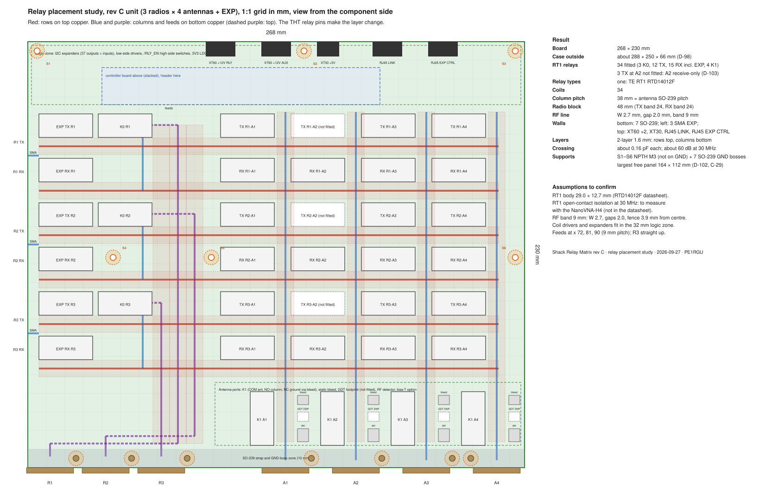

# RF board

Status: draft, 2026-10-07. Drawn from design-log.md (decisions D-, assumptions A-, calculations C-, measurements M-) and the schematic hardware/unit/rf-board/ (generator v10l). No board is built yet; values marked "to confirm" wait for a datasheet copy, a layout or a bench test.

## 1. Function and interfaces

One flat RF board per unit, in a milled aluminium case (D-01, D-02). The controller board sits above it on standoffs and the J14 header (D-51).

Unit size: 3 radios × 4 antennas (D-03). Only 3 HF coax cables run to the shack; more radios can be switched in the shack.
Unit 1 antennas: A1 G5RV, A2 RX loop (RX only), A3 and A4 spare.

Contents:

- 3 radio ports: K0 changeover, TX row and RX row. Each row has 4 antenna positions and 1 EXP position.
- 4 antenna ports: K1 ground/route relay (COM antenna, NO column, NC ground through the bleed), static bleed (1 MΩ HV, no choke, D-32), no GDT (D-114), RF detector (D-47, D-48), bias-T option (D-28, D-54).
- EXP: 5th position in each TX row and RX row; both join on one SMA per radio. The EXP relay is the series disconnect, so no open stub remains when the antenna is local. TX and RX of one radio cannot be split across units (D-04).
- Outside the matrix: FTM-510D to GP-6N straight through.

Relays: one type for all 37 positions, TE RT1 RTD14012F (D-06). Unit 1 fits 34: on the receive-only column A2 the three TX relays and their drivers are not fitted (D-103, SR-01). Reasons: one part, one footprint, one PCN watch; open contacts see up to 173 V peak; an RX relay sits on the TX line when TX and RX share an antenna.

Connectors (D-14, D-33):

- Bottom wall: radio SO-239 R1 to R3 (30 mm pitch) and antenna SO-239 A1 to A4 (38 mm pitch, under the columns). Amphenol RF 83-798, PTFE insulator (D-10).
- Left wall: 3 SMA EXP, one per radio block: bulkhead jack with a 4-hole flange, strap to a land at the board edge, as the SO-239 (D-108).
- Top wall: XT60PW-M +12V RLY, XT60PW-M +12V AUX, XT30PW-M +5V (D-17). RJ45 LINK and the EXP ribbon passage are on the controller board (D-51, D-53).
- J14, 2 × 12 header to the controller board, 3.3 V logic (D-52). Odd pins: 1 SCL, 3 SDA, 5 EXP_INT, 7 RLY_EN, 9 TX_ANY, 11 to 15 R1..R3_K0_DRV, 17 A2_RFDET (D-104), 19 to 23 spare. Even pins: 2, 4 +5V; 6 to 24 GND.

Unit 2 uses the same RF board. J14 takes the EXP ribbon from the unit 1 controller board (D-53); its 3 SMA inputs replace the radio SO-239s. Unit 2 has its own power entry.

Surge: Comet CS-400R arrestors at the RVS box entry (D-09), not on the board. DC fire 400 V ±15 % (min 340 V) against 173 V RF peak: ratio 0.51 (C-06). The CS-400R insulates (≥ 10 GΩ) below its fire voltage, so the board bleed drains static. The 12 V bias-T for the RX loop passes through it and cannot hold an arc (holdover rated at 150 V).

## 2. Circuit description

Schematic: hardware/unit/rf-board/ (rf-board.kicad_pro, generator gen_rfboard_sch.py, rf-board.pdf). 308 parts on 11 sheet instances. The schematic uses wires; labels only where a net leaves a sheet (D-30). Control lines on the root sheet run as buses (D-60).

### 2.1 Root

All connectors sit on the root sheet (D-33): radio SO-239 J1 to J3, EXP SMA J4 to J6, antenna SO-239 J7 to J10, power J11 to J13, controller header J14. The four antenna columns ANT1 to ANT4 are drawn as wires between the radio port and antenna port sheets.

### 2.2 Power, coil supply and 3V3

- Inputs: XT60 +12V_RLY, XT60 +12V_AUX, XT30 +5V. Per input a 1 A time-lag 1206 fuse at the connector, then a unidirectional TVS (SMBJ15A on the 12 V inputs, SMBJ6.0A on +5V). On reverse polarity the TVS conducts and the fuse opens (D-45).
- +12V_SW: P-MOSFET high-side switch Q1 (PMV50EPEA) from +12V_RLY, driven by Q2 (BSS138BK) from RLY_EN. R1 10k holds Q1 off; the gate divider R1 / R2 2.2k gives VGS about 10.3 V at 12.6 V. BZT52C15 across gate and source of Q1 limits VGS while the input TVS clamps. R3 100k pulls RLY_EN low, so no signal = relays off (D-38 to D-40, D-39, D-50).
- Freewheel SS14 on the +12V_SW output (D-36).
- Clamp nets: CLAMP_SW (row relays and K1) and CLAMP_RLY (K0). Each has two BZT52C24 zeners in parallel to its coil supply, so one open zener does not remove the clamp (D-35, D-43).
- 3.3 V: LP2985-33 from +5V, ON/OFF tied to the input, 1 uF in, 10 nF bypass, 4.7 uF X7R out (D-41).
- CHASSIS bond: plated lug H1 with an open solder jumper (DC bond) and a not-fitted 10 nF 1 kV footprint (RF bond), as an option (D-18).

### 2.3 Radio port (one sheet, three instances R1 to R3)

- K0 changeover: COM to the radio, NO to the TX row, NC to the RX row. Coil off = radio on the RX row (fail-safe). The K0 coil is on +12V_RLY, so RLY_EN does not cut it (D-26, D-27). R1 K0 follows the PTT loop in hardware; R2 and R3 K0 come from U903 after the handshake (D-63).
- TX row and RX row: five RT1 each (A1 to A4 and EXP). Row relay COM on the row bus (L1), NO on the column (L2), NC open (D-26).
- One coil driver per relay: BSS138BK low-side, 100k gate pull-down, 1N4148W to the clamp net (D-34, D-36, D-37, D-43). No gate zener (D-44). On the board the drivers sit in the logic zone above their relay columns; only the coil lines run to the relays (D-112).
- On the receive-only column A2 the TX relay and its driver are not fitted, in all three instances (D-103).
- EXP: the 5th position of both rows joins on one SMA. The EXP relay is the series disconnect.

### 2.4 Antenna port (one sheet, four instances A1 to A4)

- K1: COM to the antenna, NO to the column, NC to GND through the 1 MΩ high-voltage bleed (D-32). Coil off = antenna parked on the bleed.
- DC block footprint and 0R link on the column side; bias-T feed point on the matrix side of K1 (D-28). Choke and capacitor not fitted until a port needs bias.
- No GDT on the board: the CS-400R at the box entry takes the surge (D-07, D-114).
- RF detector tap: C4 4.7 pF 1 kV C0G in series, C5 47 pF to GND; BAS70-04 voltage doubler into a 10 nF hold capacitor with 2 × 47k load; DETk to the RF detect sheet (D-47, D-48).

### 2.5 RF detect

LM2901 quad comparator, one channel per antenna port. VREF 0.3 V from +3V3 (10k / 1k, 100 nF). Each channel: 10k series, 1 MΩ feedback (about 33 mV hysteresis), open-collector output with 10k pull-up to 3.3 V. RFDETk low = RF on the column (D-47). RFDET2 (A2) also goes to J14 pin 17 for the SAFE stop (D-104).

### 2.6 IO expanders

U901, U902, U903 PCA9539 at 0x74 to 0x76 on the bus from J14. RESET of every expander = RLY_EN, so no signal holds the outputs as inputs and the 100k gate pull-downs hold every coil off (D-49, D-50). Bus pull-ups on this board: 2.2k on SCL and SDA, 10k on EXP_INT (D-52, C-16). R904 100k pulls TX_ANY low with J14 open (D-61). U903 IO1_3 and IO1_4 drive the R2 and R3 K0 (D-63); IO1_5 reads TX_ANY back (D-53).

### 2.7 Bias-T supply

U1001 PCA9539 at 0x77 (RESET = RLY_EN). Per antenna port: IRFL9014 P-MOSFET high-side switch from +12V_AUX, 10R sense resistor with BC857B current limiter, BSS138BK gate drive from BIAS_EN through 47k, 100k enable pull-down, 100 nF, SMBJ15A on the output, 33k / 10k read-back to BIAS_OK. Firmware fault: EN high and OK low (D-54, C-17).

## 3. Component selection and derating

Factors from the hardware rules: power 0.6, temperature 0.8, voltage 0.7, current 0.7. Worst case: SWR 3:1 for RF (173 V peak, 2.45 A rms, C-01); +12V_RLY 12.6 V max; case air 55 °C (assumed, C-13). Datasheets and checks: Datasheets/_register.md. Halogen status: to check per part against the maker declaration (D-107).

| Part | Use | Check | Result |
|---|---|---|---|
| TE RT1 RTD14012F | All relay positions (D-06) | Coil: nominal design point, operate 8.4 V max at 23 °C against 10.3 V needed hot (C-13) | Documented exception (coil range, not a voltage factor); about 1 V margin with the MOSFET drivers |
| Amphenol RF 83-798 | SO-239 (D-10) | PTFE insulator, 173 V peak | Pass (no rated figure for RF voltage in the drawing; A-05 for the rear length) |
| PMV50EPEA (2nd AO3407A) | +12V_SW switch | VDS 12.6 / 21 V, VGS 10.3 / 14 V, drop about 15 mV at 0.33 A | Pass (D-40) |
| BSS138BK (2nd Diotec MMFTN138K, D-134) | Coil and gate drivers | RDS(on) max 6.5 Ω at 2.5 V; drain peak 37.5 V / 42 V | Pass (D-37, A-12) |
| BZT52C24 × 2 per clamp net | Coil clamp | Drain peak 12.6 + 24 + 0.9 = 37.5 V | Pass; zener pulse energy to confirm (D-43) |
| SS14 | +12V_SW freewheel | Up to about 0.43 A at switch-off | Pass (D-36) |
| 0468001.NR (2nd SF-1206S100-2) | Input fuses, 1 A T | 0.43 / 1 (RLY), 0.5 / 1 (AUX), 0.2 / 1 (+5V) at 20 °C | Re-rating at 55 °C and the PSU short-circuit current to confirm (D-45, A-13) |
| SMBJ15A, SMBJ6.0A | Input TVS | VR is the design point; 12.6 / 16.7 V and 5.25 / 6.67 V on VBR min | Documented exception (D-45) |
| LP2985-33 (2nd LD2985BM33R) | 3.3 V logic | VIN 5.25 / 16 V = 0.33. C-14 (96 mA, Tj about 93 °C) still counts the PCA9615 of D-52, which D-53 removed; the remaining load is the expanders, pull-ups and LM2901 pull-ups, a few mA | Pass; C-14 to recompute with the present load |
| PCA9539 TSSOP-24: NXP/Nexperia PCA9539PW,118, TI TCA9539PWR, Diodes PI4IOE5V9539LEX (D-133) | Expanders | 3.3 V supply; case 55 / 85 °C = 0.65 | Pass (D-49) |
| LM2901 | RF detect comparators | Inputs to 36 V; comparator input 15.4 V max: 0.43 | Pass (C-15) |
| BAS70-04 | Detector doubler | About 31 V reverse per diode against 70 V: 0.44 | Pass (C-15, D-48) |
| 4.7 pF 1 kV C0G 1206 | Detector tap | 158 V / 1 kV = 0.16 | Pass (C-15) |
| 10 nF 50 V X7R | Detector hold | DET 30.7 V / 50 V = 0.61 | Pass (C-15) |
| 1 MΩ HV (Vishay VR25 class) | Static bleed | About 950 V impulse before the CS-400R fires | Part to confirm (D-32) |
| IRFL9014 (2nd NTF2955) | Bias-T switch | Short circuit: Tj about 102 °C, 0.68 / 0.58 of Tj max; VDS 12.6 / 60 V | Pass; drain copper to confirm on the layout (C-17) |
| BC857B | Bias-T current limit | VCE 12.6 / 45 V = 0.28 | Pass (C-17) |
| 10R 0805 | Bias-T sense | 61 mW / 125 mW = 0.49 | Pass (C-17) |
| XT60PW-M, XT30PW-M | Power entry (D-17) | Rail current below 1 A | Pass; polarity on a real part (A-07) |

## 4. Calculations

RF line (C-03, D-13):

- Stackup JLC06161H-7628A, 6-layer 1.6 mm, 1 oz outer, 0.5 oz inner (D-115). L1 rows and GND pour; L2 GND; L3 routing, horizontal (coil lines, logic, rails); L4 routing, vertical; L5 GND; L6 columns, radio feeds and GND pour (D-156; L4 was GND in D-115). Outer prepreg 0.5124 mm (7628 + 7628 + 1080, Er about 4.33) on both sides.
- JLC impedance calculator (2026-10-19), coplanar single ended without solder mask, L1 ref L2, gap 2.0 mm, 50 Ω: W 0.9751 mm (C-30). Own conformal mapping gives 1.08 mm, about 10 % wider. The stackup is symmetric, so L6 ref L5 takes the same width.
- Design value: W 0.975 mm, gap 2.0 mm on L1 and L6 (D-116).
- Via fence: via centre 3.05 mm from the trace centre (0.4875 + 2.0 + 0.5 + 0.05, C-33), pitch 2.54 mm; RF band about 7.1 mm per line.
- Inner GND planes: antipad 0.5 mm around every RF pad and via (D-117).
- Current: 2.45 A rms (C-01) in 0.975 mm, 1 oz outer layer: about 11.0 °C at DC (IPC-2221), about 21 °C with skin effect at 30 MHz (C-31). The IPC-2152 record is still to do.
- Superseded: JLC0216A 2-layer, W 2.7 mm (D-11, D-13, C-03, C-10). A JLC 4-layer board was checked and rejected: its outer prepreg is at most 0.2104 mm, so a 50 Ω line is about 0.46 mm wide and rises about 48 °C at DC (D-115, C-31).

Spacing check (2026-09-27, D-12):

- Working voltage 173 V peak at SWR 3:1, about 122 V rms; creepage table row 125 V rms.
- Material: JLC gives no CTI for standard FR-4 (its own blog: about CTI 175, group IIIa). Material group IIIb is assumed (A-01).
- EN IEC 60664-1 creepage at 125 V rms, material group III (values from memory, to confirm with a copy of the standard, C-05): PD2 about 1.2 mm; PD3 about 1.9 mm. The outdoor box is taken as PD3 (A-02).
- IEC 60664-4 (above 30 kHz, range to 10 MHz): values not checked; no copy available. The 2.0 mm gap adds a small margin above the PD3 value for this.
- Clearance in air does not set the limit at 173 V peak; creepage sets the gap.
- The same gap applies to other RF copper at transmit voltage: pads of the RF relay pins to the GND pour, SO-239 pads, EXP SMA launch.

Crossing coupling: rows (L1) and columns (L6) are separated by the GND planes L2 and L5 (L4 was GND before D-156), so there is no direct capacitance at a crossing (C-32; the 2-layer value was about 0.16 pF, C-04).

Other calculations for this board, in design-log.md section 4:

- C-07: 37 RT1 positions, 400 mW per coil; unit 1 fits 34.
- C-13: coil voltage budget. Low-side MOSFET drivers leave about 1 V margin; a Darlington array would not.
- C-14: 3.3 V LDO load and heat (to recompute: the PCA9615 load is gone since D-53).
- C-15: RF detector range. Threshold about 6.9 V peak on the column (about 0.5 W at SWR 1); return loss of the tap 29 dB at 54 MHz.
- C-16: I2C pull-ups: bus about 75 pF, rise time 0.19 µs at 2.2k.
- C-17: bias-T current limit 48 to 78 mA; short-circuit heat.
- C-29: first resonance of the board on its supports, about 135 Hz (compare only).

## 5. Layout rules

Layout: hardware/unit/rf-board/rf-board.kicad_pcb, generator gen_rfboard_pcb.py (KiCad 10 Python). Status p3 (2026-10-25, M-82): silkscreen done (labels, HV warning, art block with the signature D-168, stackup legend on the back; DRC 0 violations). Before, p2d (2026-10-24, M-75 to M-79): GND stitching done (return vias by the router, edge fence, 5 mm grid; D-165). Before, p2c4: parts aligned on lines (D-158, D-163), all 168 logic, supply and bond nets routed with right-angle branches and a minimum segment of 0.4 mm (D-164; 815 vias; L3 horizontal, L4 vertical, L1 only in the logic regions and the detector and bias boxes), expander fan-out vias (D-161), DRC 0 copper violations; open: stitching vias (also one isolated In2 GND island at J12), silkscreen p3. Before: p2b (M-71, M-72): RF copper with 45-degree bends (D-158), return and fence vias and the GND pours (gen_rfboard_copper.py); antenna port parts aligned. Before: p1i (2026-10-20, M-48, M-49, M-54): all parts placed by function (D-136): 3.5 mm edge band free, each IC with its decoupling and pull-ups at the pins, the J14 filter at J14, bias-T supply as one block per port, RF detect beside K401. Open: silkscreen texts (p3). J14 position fixed by the controller board J2 (D-139). TP1, TP2, TP1201 to TP1205 and TP1209 lie under the controller board: they serve the RF board test before the controller board is fitted; in the assembled unit the controller board test points TP5 to TP9 take the bus signals (D-141). The controller board is shown in the 3D view as CTL3D (M-54). No tracks yet. Render: hardware/unit/rf-board/svg/rf-board-p1h.png.

Placement study: hardware/unit/relay-placement-study.svg (generator gen_relay_placement.py). RF bands (9 mm keep-out including gap and fence) are drawn as shaded strips. With the 6-layer stackup the band is about 7.1 mm (C-33); the placement keeps the 9 mm bands as margin.

*Relay placement study, rev C unit (gen_relay_placement.py)*

- Board 268 × 230 mm (C-12, D-23). Case outside about 288 × 250 × 66 mm (D-98).
- 37 RT1: 3 K0, 15 TX including EXP, 15 RX including EXP, 4 K1. 400 mW per coil.
- Crossbar: rows (radio TX and RX lines) horizontal on L1; columns (antenna lines) and radio feeds vertical on L6. The THT relay pins make the layer change. L2 and L5 are solid GND under the whole board, except the antipads (D-115, D-117, D-156); L3 and L4 carry the coil and logic routing.
- Column pitch 38 mm = antenna SO-239 pitch (board x 139, 177, 215, 253). Column line 6 mm from the relay body, so the 9 mm band clears the relays. Radio block 48 mm (TX band 24, RX band 24).
- Left: EXP relays (SMA on the left wall at each radio block) and K0.
- Radio SO-239 at x 12, 42, 72 (30 mm pitch, D-21). R3 feed straight up at x 72; R1 and R2 feeds at x 81 and 90, with their jogs on top copper near the bottom edge. No parallel run between feeds (D-24).
- Top 32 mm: logic zone, power entry; controller board above.
- Antenna port zone 34 mm above the strap zone: K1 left of each column; bleed and detector right of it, 2.0 mm from the column line (no GDT, D-114).
- Board supports (D-102, D-132, C-29, M-32): six M3 standoffs S1 to S6, 13 mm, plated holes, each on its own net CHASSIS_S1 to CHASSIS_S6 with its local bond option footprint (C8 to C13, DNP; no board copper between supports, D-162), 8 mm keep-out; plus the seven M3 screws to the SO-239 GND bosses at y 225 (the RF bond). Positions in case.md.
- SO-239 strap land (D-105): pad 3.5 x 4.0 mm on both layers at the board edge, 3 vias at the inner end, 2.0 mm RF clearance; plated M3 hole to the GND boss 14 mm beside the axis (left of A4), solid connection.
- Mounting holes are not grounded, except the defined CHASSIS bond (D-18).
- Markings: HV warning triangle, date code DC YYWW, no UL mark, no JLC order number (D-19).
- Return vias (D-119): every RF change L1 to L6 (relay pins, column links, SO-239 and SMA lands) gets 2 to 4 GND vias through all layers within about 1 mm.
- Pour (D-119): GND pour on L1, L3 and L6, tied to GND, stitched on a 5 mm grid. GND via fence and GND strip around the board edge on all layers. No floating copper. Fab note: "no copper to be added without approval".
- Test access (D-120): TP on each rail and on SCL, SDA, EXP_INT, RLY_EN, TX_ANY, A2_RFDET; a 0 Ω link in series with each rail entry.
- J14 crossing (D-122): sheet "J14 filter", series link R1201 to R1209 (0R) and C1201 to C1209 (DNP) on each slow line, placed at J14.
- Unused PCA9539 IO: 10 kΩ arrays RN901 to RN903, RN1001, RN1002 to GND (D-121).
- Bulk: C6, C7 47 µF 25 V polymer at the 12 V entries (D-129). Decoupling 1 µF X7R at every IC, 1 µF 50 V on +12V_SW per radio block (D-127).

Order checklist: stackup JLC06161H-7628A, impedance control yes, remark "50 ohm coplanar with GND below on L1 (ref L2) and L6 (ref L5): W 0.975 mm, gap 2.0 mm". Surface finish ENIG (HASL is not offered for 6 layers). Quote 2026-10-19: 187.34 USD for 5 boards, 8 to 9 days (A-23). Laminate standard FR-4: halogen policy set aside for this board (D-118).

## 6. Verification done

All results are desk checks on the schematic. Nothing is measured yet.

- ERC (KiCad 10.0.5): 0 errors, 0 warnings since v10k (M-35); v10l with all footprints (M-37). Earlier steps: M-04 to M-06, M-09, M-30, M-33, M-34.
- Netlist checks: each antenna column joins 6 row relays and its antenna port; each row bus joins K0 and 5 row relays (M-04 to M-06); connectivity unchanged across redraws (M-09).
- Logic verification, hardware/unit/verify/verify_logic.py with rf12.xml and ctl11.xml: 52 checks pass (M-08, M-33, M-34, M-42). It covers the topology against the netlists, the RLY_EN and reset chain, the coil drivers in every input state, the bias feeds, the K0 path, all 128 relay states per column (hazards H1 to H4), the A2 TX relays not fitted (SR-01) and the A2 RF stop on J14 pin 17.
- Timing of the switching chains on paper (M-10): KILL to coil MOSFETs off about 11 µs; contacts open about 6 ms later plus the coil decay (coil inductance not in the datasheet).
- Mutation tests: changed netlists give a FAIL in each new check (M-33, M-34).

## 7. Open items

- SR-01: H1 closed by D-103, H2 by D-104 (A2 detector to J14 pin 17, SAFE loop opens on RF at A2). To confirm: A2 detector against coupling from the other antennas (A-20).
- EN IEC 60664-1 and IEC 60664-4 copies to confirm the creepage values (C-05).
- XT polarity on a real part (A-07, M-02): vendor models put the angled end on pad 2; the KiCad footprint says pad 2 = +; convention says angled = −.
- Unit 2 build option details (SMA inputs instead of radio SO-239s; K0 on unit 2).
- SMA and RG142 rating at 173 V peak, 2.45 A rms, SWR 3, 45 °C.
- IPC-2152 record for the RF line (C-09).
- Zener pulse energy (D-43), fuse re-rating and PSU short-circuit current (D-45, A-13), bleed resistor part (D-32).
- Coil decay time and K0 release against the radio RF tail: measure on the first board (M-10, F9).
- 6-layer stackup (D-115): IPC-2152 record (C-31).
- RT1 isolation test (M-01, postponed): coupon on the board stackup (JLC06161H-7628A) with one RT1, CPWG lines from COM and NO to two edge SMA, a through line of the same length as reference, GND via fence. NanoVNA-H4, SOLT calibration at the SMA planes, 1 to 54 MHz. Measure S21 coil off, S21 and S11 coil on, NC isolation coil on; values at 1.8, 3.5, 7, 14, 21, 28 and 50 MHz.

Review against hardware-design-rules v2.2 (M-41, docs/reviews/2026-10-19-review-hdr-v2.2.md). Decisions taken 2026-10-19 and drawn in v11a / p1d (M-42, M-43): D-121, D-127 to D-129, D-132; PCA9539 in TSSOP-24 with three makers in v11b / p1e (D-133, M-46). Still open:

- Parts to confirm on DigiKey (the bot check stopped the session): bulk polymer C6, C7 and its second source; CAT16-103J4LF / YC164 arrays; about 25 parts of the register.
- To confirm in verify_logic.py: the PCA9539 reset release timing against RLY_EN (RF-10).
- After bring-up: write the detector front end, the 3V3 block and the J14 protection set as design blocks (RF-11).
- Layout p2: return vias at every L1 to L6 RF change, stitching, edge fence (D-119); silkscreen clean-up.

- Board signature (D-152): main function as an IEC logic symbol with truth table in the silkscreen art block; to choose and draw at the silkscreen pass.
- Schematic frames: done in v12a (M-69), netlist rf13.
