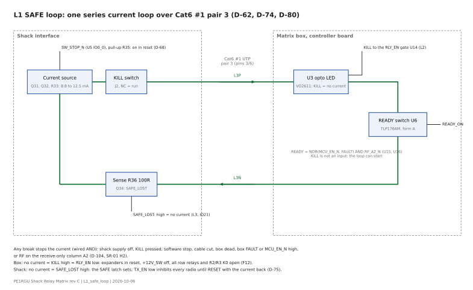
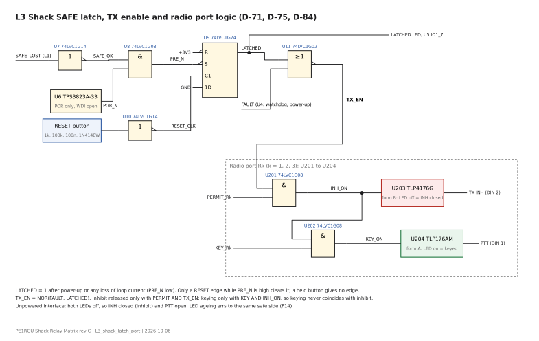
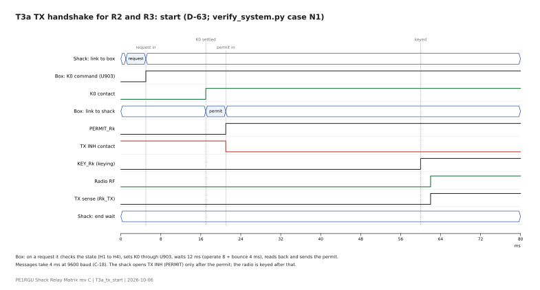
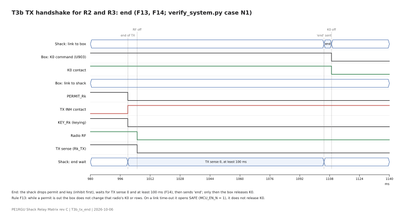
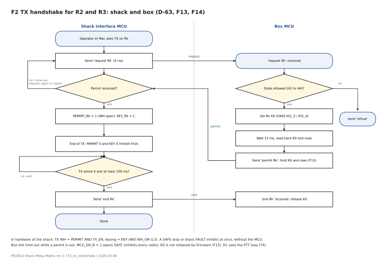

# Shack interface

Status: draft, 2026-10-25 (layout p3 routed). Drawn from design-log.md, hardware/shack-interface/shack-interface-rev-a.md and the schematic hardware/shack-interface/ (generator a12). No board is built yet; values marked "to confirm" wait for a datasheet copy, a layout or a bench test.

## 1. Function and interfaces

The shack interface is the shack end of Cat6 #1 to the matrix box. It is an own board in an aluminium housing (D-70). It works stand-alone with its USB-C to the Mac, through the Delock 64226 isolator hub (A-16, D-68, D-69). Since D-186 (p7) J14 sits at the rear edge, so all cables enter at the rear panel. A Raspberry Pi 5 can connect later over the same USB (D-65, D-67).

Functions:

- Powers the four opto current loops to the box and reads them (D-56, D-74, D-80).
- Holds the SAFE latch in hardware: a loss of SAFE loop current inhibits all radios until the operator presses RESET with the current back (D-62, D-75). No USB, Ethernet or touch command can clear the latch (D-64, D-65).
- Gives each radio its TX permit in hardware: TX INH = SAFE latch AND permit (D-63).
- Bridges the Mac to the box protocol (UART 9600 baud over loops 1 and 4, D-58).

Interfaces (all connectors on the root sheet):

| Connector | Function |
|---|---|
| RJ45 LINK | Cat6 #1, T568B: pair 1 data to the box, pair 2 PTT (R1 K0), pair 3 SAFE, pair 4 data from the box |
| 13.8 V IN | Station supply |
| KILL switch, KILL state | Two-pole KILL switch: one pole in the SAFE loop, one pole read by the expander |
| Front panel J6 | RESET button, SAFE and LATCHED LEDs |
| R1 to R3 mini-DIN 8 | Radio ports, FT-710 TUNER/LINEAR pin-out, one adapter cable per radio (D-71, D-85) |
| R1 to R3 LED | Per-radio status LEDs on the panel |
| USB-C J14 | GCT USB4105-GF-A at the rear board edge and rear plate (D-96, D-186), to the Mac or the Pi |
| CHASSIS lug | Housing bond; GDT surge path |

## 2. Circuit description

Schematic: hardware/shack-interface/ (shack-interface.kicad_pro, generator gen_shack_sch.py). 257 parts. Wires only, except net labels at the DevKit pins (D-93). Every hierarchical label sits on the same side as its pin on the root block (D-92); the remaining crossings are accepted (D-97).

### 2.1 Link to the box

- Four loops, each with its own two-transistor PNP current source on the high side: BCP53-16 pass, BC857B sense, Rsense 56 Ω, 8.8 to 12.5 mA (D-74, D-79, C-24).
- Entry per pair, as the box: GDT 2036-09-B2LF to CHASSIS, 47R per wire, SMBJ15CA across the pair (D-79).
- No optos at the shack end (D-80): pair 1 source switched by the MCU (DATA_TX); pairs 3 and 4 sensed by a 100R resistor in the return and a BC847B into 3.3 V logic (SAFE_LOST, DATA_RX); pair 2 source switched by the R1 TX sense in hardware, so the FT-710 TX GND drives K0 in the box without the MCU.
- Software stop: the expander output SW_STOP_N turns the SAFE loop source off; R35 100k pull-up keeps the loop closed while the expander is in reset (D-68).

### 2.2 Power

13.8 V input: 500 mA time-lag fuse, SS34 reverse protection, SMBJ16A TVS, 47 µF and 330 nF. L7805CV to 5 V, bolted to the housing wall (D-73, D-82). LD1117S33CTR from 5 V to 3.3 V with 22 µF X7R at the output (D-81). No switch-mode converter.

### 2.3 MCU and expander

- MCU: ESP32-C3-DevKit-RUST (RUST-1 in use, RUST-2 fits) on gold sockets, as the box (D-66, D-93 to D-95). SDA select JP61 for the two board revisions (D-94). Direct GPIO: PERMIT_R1 to R3, WDI, LATCH_CLR, DATA_TX, DATA_RX, SAFE_LOST (D-83).
- Supervisor and watchdog TPS3823A-33 with fault latch 74LVC1G74, as the box (D-59, D-66): a hang or brown-out drops the permits.
- PCA9539 at 0x74 on the board I2C, polled, RESET = RESET_N (D-68, D-92). Inputs: R1 to R3 TX sense, BAND A to D (from R1), KILL state, LATCHED. Outputs: KEY_R1 to R3, LED_R1 to R3, SW_STOP_N.
- USB: own USB-C J14 in parallel with the DevKit USB (D+, D-), ESD array USBLC6-2SC6, CC pull-downs 5k1, VBUS not connected to the DevKit (D-96). One USB-C at a time.

### 2.4 SAFE latch

- SAFE_LOST from the loop sense into a 74LVC1G14 Schmitt inverter: SAFE_OK.
- PRE_N = SAFE_OK AND POR_N (74LVC1G08). POR_N from a second TPS3823A-33 with WDI open, used as a plain supervisor (D-84).
- 74LVC1G74 SAFE latch: a loss of loop current or a power-up sets LATCHED. The RESET button (1k, 100k, 100 nF, 1N4148W, 74LVC1G14) gives one clean clock edge; it clears the latch only while PRE_N is high (D-75, D-84).
- TX_EN = NOR(FAULT, LATCHED) (74LVC1G02) to the three radio ports. SAFE and LATCHED LEDs through 680R.

### 2.5 Radio port (one sheet, three instances R1 to R3)

- TX INH: form B photorelay TLP4176G (second source AQY412S), LED = AND(PERMIT_Rn, TX_EN) through 240R, about 7 mA. No LED current = contact closed = inhibit, so an unpowered or stopped interface inhibits the radio (D-71, D-106). INH LEVEL jumper: LOW (to radio GND), HIGH (5.1 V from pin 6 through 2k2 and a BZX384-C5V1, D-90) or removed.
- Keying: form A photorelay TLP176AM (second source AQY212G3HS), LED = AND(KEY, INH_ON), to the radio PTT input (D-91, D-88).
- TX sense: PC817X with 1N4148W anti-parallel; jumpers SENSE A and SENSE K select CONTACT or VOLTAGE mode; FEED SEL selects the radio +13V OUT or the interface supply (D-72, D-78, D-88).
- Pin 1: PIN1 SEL solder jumper, BAND D (R1) or KEY (R2, R3) (D-86). BAND inputs: 1k series, 10k pull-up to 3.3 V.
- ESD and RF filter: PESD15VL1BA and 1 nF C0G per line to the port GND RGND at the connector; RGND to CHASSIS by 10 nF 1 kV (D-89). GND BOND jumper ties RGND to the interface GND (closed on R1 for the band data).
- Connector: Same Sky MD-80SM, second source Kycon KMDGX-8S-BS (D-85, D-100).

### Figures

Generated by hardware/docs/diagrams/gen_diagrams.py (SVG with editable text; PNG beside each SVG).

*L1 SAFE loop: one series current loop over Cat6 #1 pair 3*

*L3 Shack SAFE latch, TX_EN and one radio port*

*T3a TX handshake, start*

*T3b TX handshake, end*

*F2 TX handshake flow*

## 3. Component selection and derating

Factors from the hardware rules (0.6 power, 0.8 temperature, 0.7 voltage and current). Shack ambient 40 °C in the housing. Datasheets and checks: Datasheets/_register.md. Halogen status: to check per part against the maker declaration (D-107).

| Part | Use | Check | Result |
|---|---|---|---|
| BCP53-16, BC857B | Loop sources (D-79) | VCE 38 / 80 V = 0.48 (13.8 V plus TVS clamp); short 0.13 W / 0.57 W at 40 °C = 0.23 | Pass |
| L7805CV TO-220 | 5 V (D-82) | 1.2 W on the housing wall, junction about 60 °C against 100 °C | Pass; housing thermal resistance to confirm (C-25) |
| LD1117S33CTR | 3.3 V (D-81) | 115 mA / 800 mA; VIN 5.25 / 15 V = 0.35; junction about 62 °C | Pass (C-25) |
| TLP4176G (2nd AQY412S) | TX INH (D-106) | 14.4 / 350 V and 14.4 / 60 V = 0.24; LED 7 mA against 3 mA operate max | Pass |
| TLP176AM (2nd AQY212G3HS) | Keying (D-91) | 14.4 / 60 V = 0.24; LED 7 mA | Pass |
| PC817X | TX sense (D-78) | CTR margin about 3.8 at end of life | Pass (C-23); VOLTAGE-mode resistor per radio still to size |
| PCA9539 | Expander | Inputs to 5.5 V; a 5 V push-pull band output gives about 5.07 V, above 0.7 × 6 V | Depends on the FT-710 output type (A-18, D-88) |
| PESD15VL1BA (2nd CDSOD323-T15C) | Port ESD (D-89) | VRWM 15 V against 14.4 V lines; 30 kV contact | Pass (above R-12) |
| BZX384-C5V1 | INH HIGH clamp (D-90) | 21 mW / 252 mW at 45 °C = 0.08 | Pass |
| 2k2 0603 (RH) | INH HIGH source | 39 mW / 100 mW = 0.39 | Pass |
| MD-80SM | Radio connector (D-85) | 14.4 V against the 12 Vdc contact rating | Documented exception (D-87) |
| USB4105-GF-A (2nd Same Sky UJ20) | USB-C (D-96) | 5.25 / 48 V; 40 / 85 °C = 0.47 | Pass (C-26) |
| USBLC6-2SC6 | USB ESD | VBUS 5.25 V at the specified VRM | Documented exception (C-26) |
| SMBJ16A, SS34, 500 mA T fuse | Input protection | – | To check with the current budget (C-25) |

## 4. Calculations

Details in design-log.md section 4.

- C-21 and C-24: SAFE loop headroom and current spread: 8.8 to 12.5 mA; drops about 9.5 V at 12.5 mA against 12 V minimum supply.
- C-22: photorelay LED drive 7 mA from 3.3 V through 240R.
- C-23: TX sense output margin about 3.8 at end of life.
- C-25: supply budget: 3.3 V about 115 mA, 5 V about 130 mA; regulator heat.
- C-26: USB-C underload.

## 5. Layout rules

- Panel connectors at the board edge, behind the housing cut-outs: the three mini-DIN, the USB-C J14 and the RJ45.
- 7805 at the edge, bolted to the housing wall with an insulating pad (D-82).
- Radio port RGND areas stay separate from the interface GND, except through the GND BOND jumper and the 10 nF 1 kV to CHASSIS (D-89).
- TVS and 1 nF per line at the connector pins; the ESD current runs to the shield, not across the board.
- USB-C cut-out: a slot of about 13.0 × 7.0 mm (plug overmold up to 12.35 × 6.5 mm); receptacle front close to the outer wall face. To draw with the housing (D-96).
- Test access (D-120): TP1 +13V8, TP2 +5V, TP3 +3V3, one TP per mini-DIN signal line (21); R5, R6 0R links after the regulators.
- Cat6 entry (D-130): TVS, 47R, choke L1 to L4, Y-capacitor footprints C22 to C29 (DNP), GDT at the RJ45.
- Stackup 4 layers, JLC04161H-7628: F.Cu signal and pour, In1.Cu plane, In2.Cu signal, B.Cu plane (D-170; supersedes the 2-layer stackup of D-131).
- Housing Hammond 1455T1601; board 160 × 159 mm (D-171). Function zones per the reviewed zone sketch; the zone frames go on the silkscreen (D-172).
- Planes (D-173): CHASSIS strip at the rear edge with the entry block down to the Y-capacitors, a 3 mm ring on the side and front edges, and a pad round the J14 shell; one RGND island per radio port (connector side of the optos); GND for the rest. Each region on F.Cu, In1.Cu and B.Cu; every plane pad has its own via.
- Cat6 entry: the four GDTs in one row directly behind the RJ45, so the surge path to CHASSIS is short (M-88).
- USB-C J14: fixed fan-out copper with router terminals (M-89).
- Housing fit (M-92 to M-94, D-177, D-178): 1455T1601 with the removable cap on top, board parts side up in the 2nd slot from the closed bottom; panel connectors overhang the board edges by 2.0 mm and J14 sits on a 13 x 2.0 mm board tab, so each connector face is 0.3 mm from its end panel. Trim the 7805 leads to 3 mm or less.
- Front panel (D-180 to D-183, M-99, M-100; plate a4, 3D fit with the maker models): Waveshare 2inch TFT, 240 x 320 (D-187, replaces the 1.9 inch of D-180; SPI on IO2/IO9, DC/RST/backlight on the PCA9539, header J15), SAFE and LATCHED LEDs (hardware), RESET (C&K 8125SHZBE), KILL (EAO 84-5340.0020 E-stop, 2 NC, R75 2k2).
- End plates (D-179): PCBs, black mask, white silkscreen, CHASSIS plane on the inside face, bonded through the four screws; generator hardware/shack-interface/endplates/gen_endplates.py. H1 earth wire to the extrusion.
- Input range 11 to 15 V checked (C-34). TVS and 7805 capacitor exceptions recorded (D-124).

## 6. Verification done

Desk checks on the schematic; nothing is measured yet.

- ERC (KiCad 10.0.5): 0 errors, 0 warnings for every increment (M-13 to M-27, M-36).
- Netlist comparisons after each redraw: connectivity identical to the reference, apart from listed equivalent pin swaps (M-21, M-22, M-25).
- verify_system.py with si14.xml and ctl11.xml: 52 checks pass (M-45). Covers the shack loop source and software stop, the SAFE latch, TX_EN, the TX INH and keying logic per port, the part types, the Cat6 pin-out on both boards, the 256-state SAFE loop table and the TX handshake with fault cases (M-11, M-29, M-36).
- Footprints: photorelay land and MD-80SM land checked by STL export (M-26, M-27); Kycon second source against the land (M-28).

- Layout p7 (2026-10-27, D-186, M-102): J14 at the rear edge in a GND channel between the entry block and R1; port pitch 32 mm; 155 of 155 nets routed, 425 vias; DRC 0 copper violations, 0 unconnected.
- Layout p3 (2026-10-25, M-85 to M-90): placement by templates (total signal airwire 4485 mm at p1, 3871 mm at p3); 156 of 156 nets routed by the general router, 428 vias; stitching CHASSIS 165, GND 529, RGND 120; DRC 0 copper violations, 0 unconnected. Left: silkscreen findings, starved thermals, 4 hole clearances inside the J14 footprint (A-26), 4 right-angle bends.

## 7. Open items

- Layout: planes (D-173) and GDT row accepted; silkscreen p4 done (M-91, D-175: zone frames, jumper settings, labels). Board signature: SAFE latch as an IEC D flip-flop (D-176).
- A-25: Hammond 1455T1601 STEP check of the board slot and the panel cut-outs. A-26: JLCPCB check of the J14 hole clearances.

- FT-710 TX INH level and response time (A-15, M-12); band output type (A-18).
- Loop sense thresholds against 8.8 to 12.5 mA (D-80).
- Current budget and regulator heat with the chosen housing (C-25).
- Housing choice, panel cut-outs and labels (D-70, D-96).
- VOLTAGE-mode series resistor per radio (C-23).
- Firmware rules F11 to F14 (verify_system.py).

Review against hardware-design-rules v2.2 (M-41). Decisions taken 2026-10-19 and drawn in a13 / a14 (M-45, M-46): D-127, D-130, D-131, D-133 (PCA9539 TSSOP-24, three makers). Still open:

- LD1117S33 second sources: output capacitor stability per maker (SI-02).
- A-18: PCA9539 band input 5.07 V against 0.7 × VDD (SI-05).
- Loop current at 11 V input (C-34, C-24).
- Loop current source, radio port protection and SAFE latch: design blocks after bring-up (SI-06).

- Board signature (D-152): main function as an IEC logic symbol with truth table in the silkscreen art block; to choose and draw at the layout silkscreen pass.
- Schematic frames: each function in a dashed frame with a bold title, text clean-up as the controller board c13 (M-66); to do at the next schematic revision.
