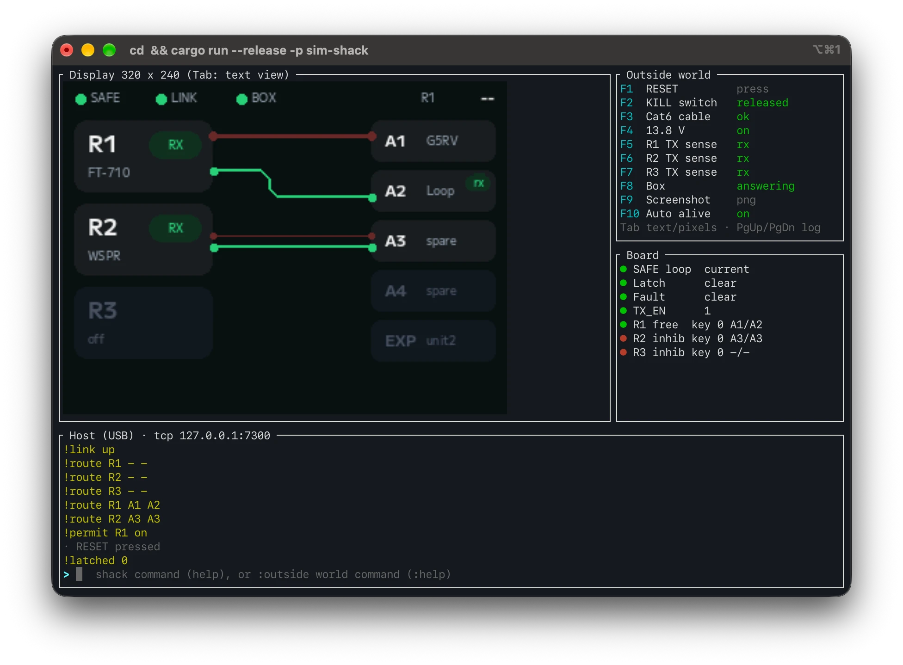
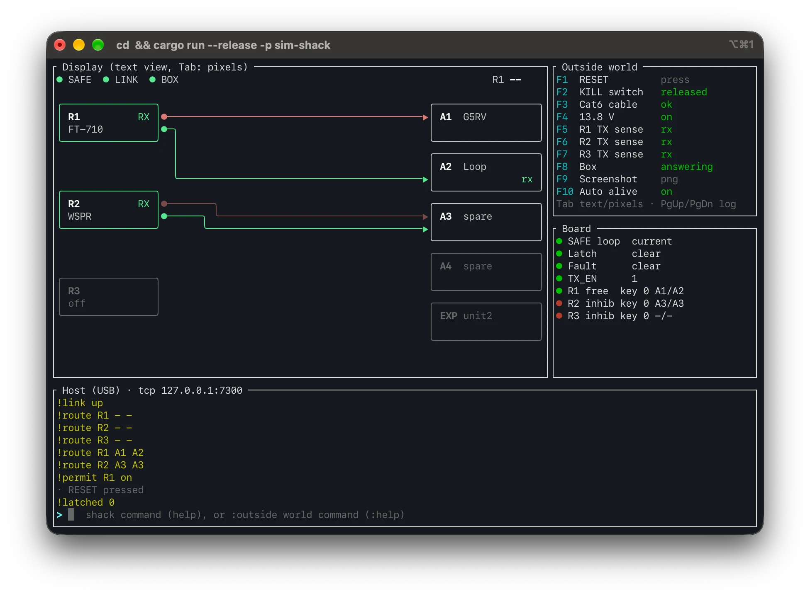
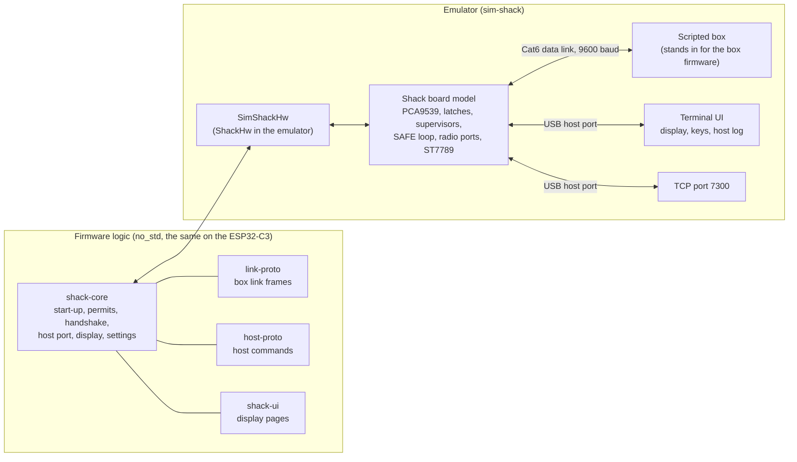

# Firmware

Rust firmware for the two ESP32-C3 controllers, developed and tested in an emulator on the computer before any board exists.

| Target | Function | State |
|---|---|---|
| Shack interface | SAFE latch read-back, TX permits and handshake, USB host port, display, stored settings | Runs in the emulator (phase P3 done) |
| Box controller (outdoor unit) | Relay matrix, safety gate, watchdog, data link to the shack | Firmware logic runs on the box board model (phase P5 done) |
| Both, joined | The two firmwares on the two boards, with the Cat6 cable between them | System scenarios with fault injection pass (phase P6 done): `cargo test -p sim-system` |

New to the code? Start with the [firmware guide](docs/guide.md): how the firmware works, one transmission followed through the code, and how to add a command, a test or a part model. Every type and function is documented in the code; open it with `./doc.sh`.

Plan and phases: [PLAN.md](PLAN.md). Firmware rules from the hardware verification: F1 to F14 in [design-log.md](../design-log.md) and [hardware/unit/verify](../hardware/unit/verify).

<p align="center">
  
  
</p>
<p align="center"><em>The emulated shack interface in a terminal. Left: pixel view (iTerm2), the display exactly as the firmware draws it. Right: text view, sharp in every terminal. Same state in both: R1 transmits on A1 and receives on A2, R2 transmits and receives on A3.</em></p>

## Contents

- [Quick start](#quick-start)
- [How the emulator works](#how-the-emulator-works)
- [The screen](#the-screen)
- [Keys](#keys)
- [Commands](#commands)
- [A first session](#a-first-session)
- [Display views and terminals](#display-views-and-terminals)
- [Stored settings](#stored-settings)
- [Connect a host program](#connect-a-host-program)
- [Command-line options](#command-line-options)
- [Troubleshooting](#troubleshooting)
- [Tests](#tests)
- [Code layout](#code-layout)
- [ESP32-C3 targets](#esp32-c3-targets)
- [Code documentation](#code-documentation)

## Quick start

1. Install Rust from [rustup.rs](https://rustup.rs). The file `rust-toolchain.toml` selects the right version and targets by itself.
2. Clone the repository and go to this folder:

```bash
git clone https://github.com/PE1RGU/hf-antenna-switch.git
```

```bash
cd hf-antenna-switch/firmware
```

3. Start the emulator:

```bash
cargo run --release -p sim-shack
```

The first build takes one to two minutes. The emulator runs on macOS, Linux and Windows.
For the sharpest display use a terminal with images: iTerm2 (macOS), WezTerm, kitty, or Windows Terminal 1.22 or later. Any other terminal shows the text view.

Quit with **Ctrl-C**.

## How the emulator works

The firmware is split in two parts:

- **The logic** (`crates/`): every decision of the shack interface, written as `no_std` Rust. It does not touch hardware directly. It asks for hardware through one small trait, `ShackHw`: the I2C bus, the permit and watchdog pins, the box link UART, the USB port, the display SPI and the settings flash.
- **The glue**: an implementation of `ShackHw`. On the ESP32-C3 it uses `esp-hal`. In the emulator it uses models of the parts on the board.

The emulator therefore runs the **same logic code** that goes into the ESP32-C3. It does not emulate the processor. It emulates the board around it.



What is modelled:

| Part | Model | Source |
|---|---|---|
| PCA9539 I/O expander | Register level: output register 0xFFFF after reset, pointer toggles in its pair, reset by RESET_N | Datasheet, rule F1 |
| TPS3823 supervisor and watchdog | Reset time 120 / 200 / 300 ms, watchdog 0.9 / 1.6 / 2.5 s (min / typ / max) | Datasheet, C-19 |
| 74LVC1G74 latches | Fault latch and SAFE latch with preset and clock | D-59, D-75 |
| SAFE loop | One series loop: power, software stop, KILL, cable, box READY | verify_system.py |
| Radio ports | TX INH and keying per port, TX sense per radio | D-63, D-71 |
| PTT loop | Follows the R1 TX sense, without the MCU | D-63 |
| Box data link | UART at 9600 baud: each byte takes 1.04 ms; a cut cable loses the bytes | D-58 |
| ST7789 display | 240 x 320 frame memory, landscape addressing, D/C and reset on the expander | D-180, D-187 |
| USB host port | Byte stream to the terminal UI and the TCP port | host-protocol.md |
| Settings flash | A file on the computer (`shack-sim-state.bin`) | host-protocol.md 8a |
| Box | A scripted stand-in: routes, K0 with a 12 ms settle time, hazard and permit rules, link time-out | link-protocol.md |

Time is virtual and follows the wall clock in the terminal UI. The logic runs its main loop every 10 ms, as on the ESP32-C3. The emulator advances in steps of 1 ms.

What the emulator is not:

- It does not show the processor's speed or memory use. Those are measured on the board (phase P7).
- In the `sim-shack` program the box is a script, not the box firmware. The joined system with both firmwares runs in the tests of `sim-system` (P6), not yet in the terminal UI.
- The radios are simple: a TX sense on or off. There is no RF, no SWR and no relay contact bounce.

## The screen

| Area | Content |
|---|---|
| Display (left) | The shack display as the firmware draws it: page B (radios, antennas and their routes), page C (one card per radio), or the Safe stop screen when the SAFE latch or a fault blocks TX |
| Outside world (top right) | What you can do to the station, with its key and its present state |
| Board (right) | Signals on the emulated board: SAFE loop current, SAFE latch, fault latch, TX_EN, and per radio: inhibited or free, key contact, route |
| Host (bottom) | Everything on the USB host port: your commands (`>`), answers (`ok`, `err`), events (`!`), log lines (`#`), and emulator notes (`·`). The last line is the command line |

On the display, red is transmit and green is receive. A thick red route means the radio transmits now. A thin red route is a transmit route that is ready but not in use.

## Keys

| Key | Action |
|---|---|
| F1 | Press RESET (clears the SAFE latch, as the button on the front panel) |
| F2 | Press or release the KILL switch |
| F3 | Cut or restore the Cat6 cable |
| F4 | Switch the 13.8 V supply off or on. Off: the MCU stops. On: it starts from boot, with the stored settings, and the SAFE latch needs RESET |
| F5, F6, F7 | Radio R1, R2, R3: press or release its PTT. The radio transmits only when it is not inhibited (TX INH), as a real radio; the Board panel shows `TX` or `blocked` |
| F8 | Box stops or resumes answering (box hang, or the data pair broken) |
| F9 | Save the display as a PNG at full resolution (`shack-display-1.png`, ...) |
| F10 | Auto keep-alive on or off (see [Commands](#commands)) |
| Tab | Switch the display between text view and pixel view |
| PgUp, PgDn | Scroll the host log |
| Enter | Send the command line |
| Esc | Clear the command line |
| Ctrl-C | Quit |

On a Mac keyboard, the F-keys may need the **fn** key.

## Commands

### Shack commands

Type these on the command line. They go to the emulated shack interface over its USB port, exactly as a host program would send them. `help` or `?` lists them.

| Command | Does |
|---|---|
| `hello` | Identify (firmware version, protocol version) |
| `status` | The full state in one line |
| `route R1-R3 <tx> <rx>` | Route a radio: transmit column and receive column, `A1` to `A4`, `EXP`, or `-` for none |
| `tx R2\|R3 on\|off` | Ask the box for the transmit permit (handshake), or end transmission |
| `key R1-R3 on\|off` | Key a radio through the interface. Works only while its permit is out |
| `bias <A2,A3 \| ->` | Bias-T feeds on for these columns, off for the rest |
| `stop on\|off` | Software stop: opens the SAFE loop. The SAFE latch then needs RESET |
| `clearfault` | Clear the fault latch after a supervisor reset (watchdog or brown-out) |
| `page b\|c\|auto` | Display page: B flow, C cards, or both in turn (B 10 s, C 5 s) |
| `name A1-A4\|EXP\|R1-R3 <name>` | Name an antenna or a radio, 1 to 8 characters |
| `names` | All names |
| `keepalive 2-60` | Host keep-alive time-out in seconds |
| `events on\|off` | Events (`!` lines) on or off |
| `help` or `?` | The command list |

The full protocol, with every answer, event and error code: [docs/design/host-protocol.md](../docs/design/host-protocol.md).

Three rules from the protocol that you meet quickly:

- **R1 has no `tx` command.** R1 (the FT-710) keys its own changeover relay through the hardware PTT loop. Its permit is on while its transmit column is routed and the box is ready. `tx R1 on` answers `err notforr1`.
- **A transmit request needs a transmit route.** `tx R2 on` with no transmit column for R2 gives `ok` (accepted) and then `!refused tx R2 on notxroute` (the box refused it).
- **Keep-alive.** While a radio has `tx` or `key` on, the host must send a line at least every 2 s, or the shack ends the transmission. The terminal UI does this for you (auto keep-alive, F10). Switch it off to test the time-out.

### Outside-world commands

Type these with a leading `:`. `:help` or `:?` lists them.

| Command | Same as |
|---|---|
| `:reset` | F1 |
| `:kill on\|off` | F2 |
| `:cable on\|off` | F3 |
| `:power on\|off` | F4 |
| `:radio R1-R3 on\|off` | F5 to F7 |
| `:radio R1-R3 noinh on\|off` | A radio without a TX INH input: it transmits while inhibited (to test rule F15) |
| `:box mute on\|off` | F8 |
| `:shot <file.png>` | F9, with a file name |

## A first session

1. Start the emulator. The display shows **Safe stop** with "Press RESET": after power-up the SAFE latch is always set.
2. Press **F1**. The latch clears and the display shows page B.
3. Route R1 to transmit on A1 and receive on A2:

```
route R1 A1 A2
```

   A thin red line runs to A1, a green line to A2. The Board panel shows `R1 free`: R1 may transmit.

4. Press **F5**: R1 transmits. The red line turns thick. Press F5 again to stop.
5. Route R2 and ask for a transmit permit with the handshake:

```
route R2 A3 A3
tx R2 on
key R2 on
```

   The log shows `!tx R2 requesting`, `!tx R2 permitted`, `!permit R2 on`. End it with `tx R2 off`: the shack inhibits the radio first, waits for the TX sense and at least 100 ms, then the box releases the relay (rule F14).

6. Press **F2** (KILL). The Safe stop screen takes over with the cause and the steps. Press F2 again, then F1.
7. Name an antenna and change the page:

```
name A3 Hexbeam
page c
```

8. Quit with Ctrl-C and start the emulator again. The routes, the names and the page come back from the stored settings. Transmission never comes back by itself, and the SAFE latch needs RESET again.

## Display views and terminals

| View | What you see | Where |
|---|---|---|
| Pixel view | The 320 x 240 picture exactly as the firmware draws it for the ST7789 | Terminals with an image protocol: iTerm2, WezTerm, kitty, Windows Terminal 1.22 or later. Other terminals show coloured blocks, which blur small text |
| Text view | The same pages drawn with characters and lines, from the same state and the same words | Every terminal, including macOS Terminal and the old Windows console |

The emulator picks the view from what the terminal supports. The first grey line in the host log names the choice, for example `display: Iterm2 images, font 14x30 px; pixel view`. **Tab** switches at any time. `--view pixels` or `--view text` sets the view at start.

**F9** saves the pixel picture as a PNG, whatever the view.

## Stored settings

The shack interface keeps its set-up over a power cycle, so you can switch on and continue (host-protocol.md section 8a):

| Stored | Not stored |
|---|---|
| Antenna and radio names | Transmit requests and keys: a restart never starts a transmission |
| The route of each radio, as the box accepted it | The keep-alive time-out (back to 2 s) |
| Bias-T columns | The software stop |
| The display page | |

The settings are saved 2 s after the last change, so a burst of commands gives one flash write. When the box link comes up, the shack sends the stored routes and bias to the box again; the box checks them like any command. This also restores the routes after a box restart.

In the emulator the "flash" is the file `shack-sim-state.bin` in the folder where you start it. Delete the file to start with the defaults. `--state <file>` uses another file.

## Connect a host program

A host program (a station program on the Mac, or the Raspberry Pi later) talks the same text protocol as the command line.

**TCP, all systems.** The emulator listens on 127.0.0.1:7300:

```bash
nc 127.0.0.1 7300
```

Then type `hello`, `status`, and so on. One host program at a time; it runs next to the command line in the terminal UI.

**Pseudo-terminal, macOS and Linux.** A serial device, as the real USB port will be:

```bash
cargo run --release -p sim-shack -- --pty
```

It prints a device path, for example `/dev/ttys003`. Open it with a serial terminal or a script. This mode has no terminal UI: the terminal where the emulator runs takes the outside-world commands without the `:` (`reset`, `kill on`, ...).

## Command-line options

| Option | Effect |
|---|---|
| (none) | Terminal UI |
| `--view text\|pixels` | Start in this display view |
| `--state <file>` | Stored settings file (default `shack-sim-state.bin`) |
| `--tcp <port>` | TCP host port (default 7300) |
| `--no-tcp` | No TCP host port |
| `--pty` | Host port on a pseudo-terminal, no terminal UI (macOS, Linux) |
| `--demo` | Print a timeline of a start-up and one transmission, then exit |
| `--probe` | Print what the display detection sees, then exit |

## Troubleshooting

| Symptom | Cause and fix |
|---|---|
| The display stays empty | The terminal claims image support that it does not have. Run `cargo run --release -p sim-shack -- --probe` and look at the `query` and `result` lines; start with `--view text` meanwhile |
| The picture is small or blurred | Blurred: the terminal has no image protocol; press Tab for the text view. Small: the font size is wrong; `--probe` shows the one used |
| The terminal is scrambled after a crash | Type `reset` and press Enter |
| `!host timeout` | No host line for 2 s while a radio had `tx` or `key` on. Turn auto keep-alive on (F10), or set `keepalive 60` |
| `err notforr1` | R1 uses the hardware PTT loop: press F5, or use `key R1 on` |
| `!txsense R2 nopermit` | R2 transmits without its permit: in the emulator a `noinh` radio; on the station a radio without TX INH, or a wiring fault. A warning only (rule F15, D-188) |
| A radio shows `blocked` | It wants to transmit but is inhibited: give it a permit (R1: a transmit route; R2, R3: `tx R2 on`), and clear the SAFE latch with RESET |
| `!refused ... notxroute` | Give the radio a transmit column first (`route R2 A3 A3`) |
| `!refused ... hazard` | The route breaks a relay matrix rule: a transmit row on the receive-only A2, or two radios on one transmit column |
| `TCP port 7300 not free` | Another emulator runs, or use `--tcp <port>` |

## Tests

```bash
./check.sh
```

This runs what CI runs: formatting, clippy, all tests, a build of every logic crate for the ESP32-C3 (`riscv32imc-unknown-none-elf`), and a build of the ESP32-C3 target. CI also runs the emulator tests on Ubuntu, macOS and Windows.

The tests check the firmware against the hardware design:

- The board model reproduces the shack checks of `verify_system.py`: the SAFE loop as a wired AND, latch sequences L1 to L5, the inhibit and keying table of every port, the shack MCU hang (E3).
- Firmware scenarios: start-up order (F1, LATCH_CLR once, watchdog kick), the R2 handshake, the F14 end rule with short and long RF tails and a failed TX sense opto, link loss with a permit out (F13), the R1 permit, refused requests, software stop, expander loss, the host protocol, stored settings over a power cycle and a box restart.
- The display: what lands in the emulated ST7789 equals a direct render of the firmware state, pixel for pixel.
- Each firmware rule was broken on purpose once, to show that a test catches it.

## Code layout

| Folder | Content |
|---|---|
| `crates/link-proto` | Box link: frames (COBS, CRC-16), messages, link state machines ([link-protocol.md](../docs/design/link-protocol.md)) |
| `crates/host-proto` | Host protocol: command parser, answers, events ([host-protocol.md](../docs/design/host-protocol.md)) |
| `crates/pca9539` | I/O expander driver with the F1 write order |
| `crates/shack-core` | Shack interface logic: `Shack::tick` every 10 ms, the `ShackHw` trait, pin map, stored settings |
| `crates/box-core` | Box logic: `RelayBox::tick` every 1 ms, the `BoxHw` trait, the crossbar check (H1 to H4), pin map |
| `crates/shack-ui` | Display pages, theme and fonts (M+ FONTS, anti-aliased), frame buffer, ST7789 commands. Mock-ups: [docs/design/display-mockups](../docs/design/display-mockups) |
| `sim/sim-core` | Emulator core: virtual time, trace, I2C and UART plumbing, embedded-hal adapters |
| `sim/sim-models` | Part and board models: PCA9539, TPS3823, 74LVC1G74, RT1 relay, ST7789, the shack board and the box board |
| `sim/sim-shack` | The shack emulator: harness, scripted box, terminal UI, text view, tests |
| `sim/sim-box` | The box emulator: harness, scripted shack, scenario tests |
| `sim/sim-system` | Both firmwares, both boards and the Cat6 cable; system scenarios with fault injection |
| `targets/shack-esp32c3` | ESP32-C3 binary: `ShackHw` on esp-hal, main loop every 10 ms. Flash with `cargo run --release` in that folder (espflash) |
| `targets/box-esp32c3` | ESP32-C3 binary: `BoxHw` on esp-hal, main loop every 1 ms, debug log on USB (phase, fault and flag changes) |

The logic crates are `no_std` and build for the ESP32-C3. The emulator crates need `std`.

## ESP32-C3 targets

Development runs in the emulator. The ESP32-C3 targets are only built until phase P7: no board exists yet.

Tools for P7:

- Rust stable with `riscv32imc-unknown-none-elf` (set by `rust-toolchain.toml`).
- espflash 4: `cargo install espflash --locked`.

Flash the shack target and open its log (P7):

```bash
cd targets/shack-esp32c3 && cargo run --release
```

The present target is a bring-up stub: version log, I2C scan (bare DevKit-RUST-1: 0x68 IMU, 0x70 SHTC3), LED blink on GPIO7.

## Code documentation

- [docs/guide.md](docs/guide.md): the firmware guide for hobby programmers. The big picture, the Rust ideas used, one tick, one transmission followed through the code, where the safety rules are, and step-by-step how-tos.
- The code documentation (rustdoc): every crate, type and function, with the design decision or rule it implements. Build it and open it in the browser:

```bash
./doc.sh
```

`doc.sh` builds the documentation of our crates only, serves it on http://localhost:8765 and opens the browser. Stop it with Ctrl-C. It needs Python 3 (on macOS and most Linux systems it is there).
Why a local server: opened from disk (a `file://` address), Safari does not load the style sheets, and the pages look plain. In Chrome, Firefox or Edge, `cargo doc --no-deps --open` also works. The gear icon at the top right of each page has light and dark themes.

Good starting points: `shack_core::shack::Shack` (the logic), `shack_core::hw::ShackHw` (the boundary to the hardware), `sim_shack::ShackSim` (the emulator).

Every public item must have documentation: `./check.sh` and CI fail on a missing one, and on a broken link. The examples in the documentation run as tests.
