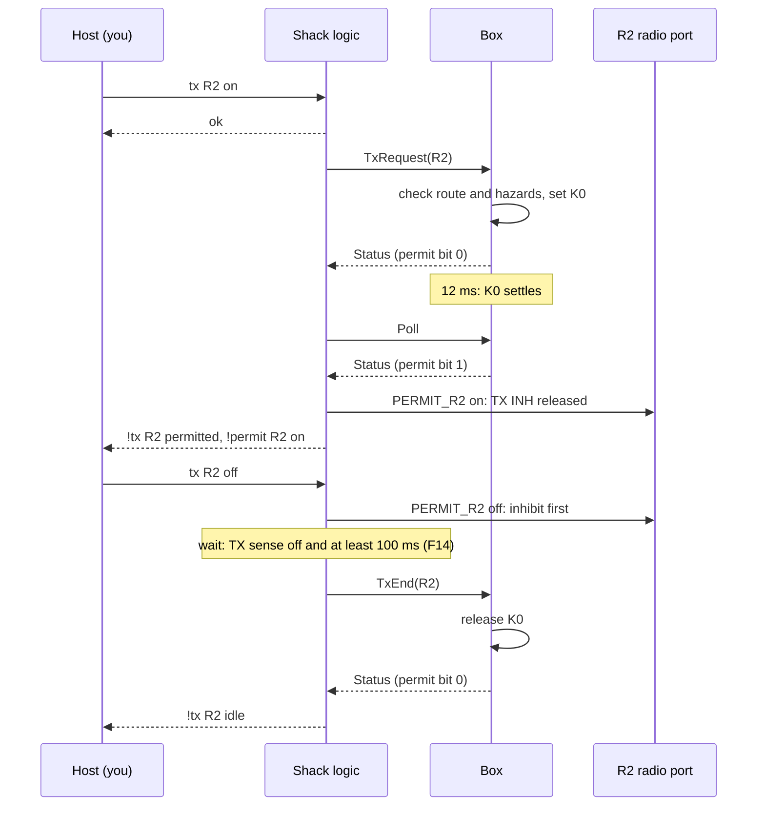

# Firmware guide for hobby programmers

This guide explains how the firmware works and how to change it.
It is for radio amateurs who know electronics and some Rust, but who are not Rust experts.

You need: Rust installed (see [README.md](../README.md), "Quick start"), and the Rust basics: `fn`, `struct`, `enum`, `match`.
This guide explains the rest when you meet it.

The details of every type and function are in the code documentation (rustdoc). Open it with:

```bash
./doc.sh
```

It builds the documentation, serves it on http://localhost:8765 and opens the browser (stop with Ctrl-C). Do not open the files from disk in Safari: Safari then drops the style sheets, and the pages look plain.

## Contents

1. [The big picture](#1-the-big-picture)
2. [Rust ideas you meet in this code](#2-rust-ideas-you-meet-in-this-code)
3. [One tick of the shack interface](#3-one-tick-of-the-shack-interface)
4. [Follow one transmission](#4-follow-one-transmission)
5. [Where the safety is](#5-where-the-safety-is)
6. [How to: add a host command](#6-how-to-add-a-host-command)
7. [How to: write a scenario test](#7-how-to-write-a-scenario-test)
8. [How to: add a part model](#8-how-to-add-a-part-model)
9. [How to: change the display](#9-how-to-change-the-display)
10. [Check your work](#10-check-your-work)
11. [Where to read on](#11-where-to-read-on)
12. [Words used in this code](#12-words-used-in-this-code)

## 1. The big picture

The firmware has two halves.

- **The logic** decides everything: when a radio may transmit, what the display shows, what goes over the link to the box. It lives in `crates/`. It never touches hardware directly.
- **The hardware access** reads and writes pins, buses and ports. On the ESP32-C3 this is `esp-hal` (from phase P7). In the emulator it is a set of models of the parts on the board.

Between the two halves there is one Rust trait: `ShackHw` in `crates/shack-core/src/hw.rs`.
Think of it as a connector with a fixed pin-out. The logic plugs into it. The real board and the emulator each provide a mating half.

```
            crates/ (logic)                          the other half
 ┌──────────────────────────────────────┐      ┌───────────────────────────────┐
 │ shack-core   Shack::tick every 10 ms │      │ ESP32-C3: esp-hal (P7)        │
 │ link-proto   box link frames         │ ShackHw │                               │
 │ host-proto   host text commands      │◀────▶│ Emulator: SimShackHw, with    │
 │ shack-ui     display pages           │      │ models of the board's parts   │
 │ pca9539      expander driver         │      │ (sim/sim-models, sim-shack)   │
 └──────────────────────────────────────┘      └───────────────────────────────┘
```

Because the logic only knows the trait, the emulator runs **the same logic code** that goes into the ESP32-C3.
The emulator does not emulate the processor. It emulates the board around it.

## 2. Rust ideas you meet in this code

**`no_std`.**
The logic crates start with `#![no_std]`. They do not use the Rust standard library, so they run on the ESP32-C3 without an operating system.
There is no heap: no `Vec`, no `String`, no `Box`.
Fixed-size versions come from the crate `heapless`: `heapless::Vec<T, 8>` holds at most 8 items, and `heapless::String<48>` holds at most 48 bytes.

**Traits.**
A trait is a list of functions that a type promises to provide. `ShackHw` is one:

```rust
pub trait ShackHw {
    type I2c: embedded_hal::i2c::I2c;
    fn i2c(&mut self) -> &mut Self::I2c;
    fn set_permit(&mut self, radio: Radio, on: bool);
    fn safe_lost(&mut self) -> bool;
    // ... UART, USB, display SPI, settings flash
}
```

The logic is written against the trait, not against a type: `fn tick<H: ShackHw>(&mut self, now: Ms, hw: &mut H)`.
The `<H: ShackHw>` part means: "any type `H` that provides the `ShackHw` functions". The compiler makes one copy of `tick` for each such type.

**State machines.**
Most logic is a state machine: a value that says where we are, and code that moves it on.
For example, the transmit state of R2 and R3 is an enum:

```rust
pub enum TxState {
    Idle,
    Requesting,               // TxRequest sent, no permit yet
    Permitted,                // the box gave the permit; PERMIT is on
    Ending { since: Ms },     // inhibited at `since`, waiting (rule F14)
    Releasing,                // TxEnd sent, waiting for the box
}
```

Each tick looks at the state and at the inputs, and may move to the next state. Nothing blocks or waits: the code returns, and the next tick looks again.

**`Option` and `Result`.**
`Option<T>` is "a `T`, or nothing" (`Some(x)` or `None`). `Result<T, E>` is "a `T`, or an error `E`" (`Ok(x)` or `Err(e)`).
The `?` operator returns early on `None` or `Err`.

**Time as a number.**
The logic gets the time as an argument: `now: Ms`, milliseconds since start-up. It never reads a clock itself.
That is why the emulator can run ten minutes of station time in a test that takes a second.

**Shared board in the emulator.**
In the emulator, several parts of the program use the same board model: the firmware glue, the scripted box, the terminal UI.
Rust allows that with `Rc<RefCell<ShackBoard>>`: `Rc` is a shared handle, and `RefCell` lets you borrow the board for a moment (`board.borrow_mut()`). This is in the emulator only; the logic crates do not need it.

## 3. One tick of the shack interface

`Shack::tick` (in `crates/shack-core/src/shack/mod.rs`) runs every 10 ms. In order:

1. **SAFE loop.** Read GPIO21: is there SAFE loop current?
2. **Stored settings.** On the first tick only: load the names, routes, bias and page from flash.
3. **Expander.** If needed, set up the PCA9539 (outputs first, then configuration: rule F1). Then read its inputs: TX sense of each radio, R1 band data, KILL switch, SAFE latch.
4. **Box link in.** Feed the received UART bytes to the link decoder. A complete answer from the box updates the box status.
5. **Host port in.** Read the USB lines from the computer, and answer each command.
6. **Keep-alive and restore.** End TX if the host went silent (section 8 of host-protocol.md). After a link-up, send the stored routes back to the box.
7. **TX state machines.** Move R2 and R3 on (request, permit, end).
8. **Box link out.** Send the next command to the box, or a poll.
9. **Outputs.** Set the PERMIT lines and the expander outputs (keys, software stop). Permits that go off are written first: inhibit first.
10. **Host port out.** Send events (`!` lines) for everything that changed.
11. **Display.** Start the ST7789, or send the next part of a frame (48 rows per tick).
12. **Save settings.** If something changed 2 s ago, write the settings to flash.
13. **Watchdog.** Toggle WDI, last, after all the checks (D-59). A firmware hang stops the toggling, and the supervisor sets the fault latch, which inhibits every radio in hardware.

## 4. Follow one transmission

You type `tx R2 on`, then later `tx R2 off`. This is what happens.



Where each step is in the code:

| Step | Code |
|---|---|
| The line `tx R2 on` is read and parsed | `host_proto::parse` turns text into `HostCommand::Tx { radio, on }` |
| The command is carried out | `Shack::host_command` (in `shack/host.rs`) calls `Shack::set_tx` |
| The request is queued | `Shack::step_tx` sees `want_tx` and queues `Command::TxRequest(R2)` |
| The frame goes out | `ShackLink::transmit` gives a frame; `Frame::encode` makes the bytes (COBS, CRC-16); the UART sends them |
| The box answers | The decoder rebuilds the frame; `ShackLink::receive` gives the event; `Shack::on_reply` sees the permit bit and moves R2 to `Permitted` |
| The radio is released | `Shack::apply_outputs` sets PERMIT_R2; the hardware gate (permit AND not latched AND no fault) frees TX INH |
| The end | `set_tx(R2, false)` moves R2 to `Ending`; `apply_outputs` drops the permit at once; `step_tx` sends `TxEnd` only after the F14 wait |

The box firmware is `RelayBox` in `crates/box-core`, behind its own trait `BoxHw`. The emulator program runs it on the box board model, joined to the shack by the four Cat6 pairs (`SystemSim`, in `sim/sim-shack/src/system.rs`). For tests of one side alone there are two scripts: `BoxStub` (in `sim/sim-shack/src/box_stub.rs`) stands in for the box in the shack tests, and `ShackStub` (in `sim/sim-box`) stands in for the shack in the box tests.

## 5. Where the safety is

The rule of the whole design: **the firmware asks, the hardware decides.**
A radio can only transmit when the hardware allows it: the SAFE latch is clear, the fault latch is clear, the permit is on, and (for R2 and R3) the box confirmed its relay.
The firmware can only make things safer on its own: drop a permit, open the SAFE loop.

The firmware rules from the hardware verification, and where they are kept:

| Rule | What | Where in the code | Test |
|---|---|---|---|
| F1 | Write the expander outputs before its configuration | `pca9539::Pca9539::init` | `start_up_order`, `f1_config_before_output_keys_the_radio` |
| D-59 | LATCH_CLR only once at start-up, after the self-test (the expander set-up); not again after a later fault | `Shack::tick` (expander set-up), `clearfault` | `start_up_order`, `expander_lost_drops_permits_and_sets_up_again` |
| F11, F5 | Box start-up: LATCH_CLR edge, MCU_EN_N low, wait for KILL = 0, then set up the expanders. After KILL, set them up again; the relays come back off | `RelayBox::tick`, `RelayBox::set_up` | `start_up_order_f11_f1`, `kill_releases_and_the_box_sets_up_again_f5` |
| F6 | Check every new relay state against H1 to H4 before a relay moves | `crossbar::check`, `RelayBox::set_route` | `hazards_are_refused_f6`, `counts_match_logic_verification_section_7` |
| F10 | Open, wait 12 ms, K1 on, wait, close, wait, K1 off. One write only opens or only closes; no step while TX_ANY = 1 | `RelayBox::switch_step` | `route_change_follows_section_8`, `tx_any_refuses_and_pauses_the_sequence` |
| F13 | The box keeps K0 while a permit is out; a link loss opens SAFE | `RelayBox::on_link_lost` (box side), `Shack::on_link` (shack side) | `link_loss_with_permit_opens_safe_f13`, `link_loss_with_permit_out` |
| F14 | At TX end: inhibit first, then wait for TX sense off and 100 ms | `Shack::step_tx`, `Shack::apply_outputs` | `tx_end_waits_for_tx_sense_and_100_ms` |
| F15 | TX sense without the permit (a radio that ignores TX INH, or a wiring fault): warn, stop nothing (D-188) | `Shack::check_tx_without_permit` | `tx_without_permit_raises_the_alarm`, `rf_tail_within_the_grace_is_no_alarm` |
| Watchdog | WDI toggles only from the main loop, after the checks of the pass (D-59) | `Shack::tick` | `shack_mcu_hang`, `watchdog_kick_comes_after_the_checks` |
| Self-test | At power-up each board proves its supervisor trips, its latches work and (box) its safety gate opens, before TX or relays are allowed. A fail blocks until a power cycle | `Shack::self_test_*`, `RelayBox::self_test` | `sim-shack/tests/selftest.rs`, `self_test_*` in `sim-box`, `both_self_tests_pass_and_a_failed_box_shows_at_the_shack` |

The tests are in `sim/sim-shack/tests/`, `sim/sim-box/tests/`, `sim/sim-system/tests/` and `sim/sim-models/tests/`. The system tests also check one rule across both ends at every ms: R2 or R3 is released only while its K0 in the box is settled on the TX row (D-63).
Each rule was once broken on purpose, to show that its test catches it.

## 6. How to: add a host command

Example: a command `uptime` that answers `ok uptime <seconds>`.

1. **Write it in the spec first.** Add a row to section 5 of `docs/design/host-protocol.md`. The protocol is shared with host programs, so the spec comes first.
2. **Parse it.** In `crates/host-proto/src/lib.rs`:
   - add a variant `Uptime` to `enum HostCommand`,
   - in `parse`, add `else if is("uptime", 1) { Ok(HostCommand::Uptime) }`,
   - in `impl fmt::Display for HostCommand`, add `HostCommand::Uptime => f.write_str("uptime")`,
   - add a line to the `HELP` list.
3. **Test the parser.** In `crates/host-proto/tests/lines.rs`, add `("uptime", HostCommand::Uptime)` to the list in `every_command_parses`, and `Just(HostCommand::Uptime)` to the `command()` strategy (that one checks that what a host writes, the shack reads back the same).
4. **Carry it out.** In `crates/shack-core/src/shack/host.rs`, in `host_command`, add an arm to the `match`. It writes the answer into a `heapless::String` with `write!` and returns `Ok(Some(answer))`. The compiler tells you where an arm is missing: Rust checks that a `match` covers every variant.
5. **Test it end to end.** In `sim/sim-shack/tests/host.rs`:

```rust
#[test]
fn uptime_answers() {
    let mut s = ShackSim::new();
    s.start();
    assert!(s.host("uptime").starts_with("ok uptime "));
}
```

6. **Try it** in the emulator: `cargo run --release -p sim-shack`, then type `uptime`.
7. **Run `./check.sh`.**

## 7. How to: write a scenario test

A scenario test runs the firmware logic on the emulated board, in virtual time, and checks what happened.
The tests are in `sim/sim-shack/tests/`. The tools:

| Call | Does |
|---|---|
| `ShackSim::new()` | A powered board with the firmware, and the scripted box |
| `s.start()` | Run until the link is up, press RESET: ready to transmit |
| `s.host("route R2 A1 A1")` | Send a host line, run until the answer, return it |
| `s.run(500)` | Run 500 ms |
| `s.run_until(1000, \|s\| condition)` | Run until the condition holds, at most 1000 ms |
| `s.board.borrow_mut().set_env(\|e\| e.kill_pressed = true)` | Change the outside world (KILL, cable, power, radio TX sense) |
| `s.boxs` | The scripted box: its routes, its K0 state, its log of commands |
| `s.board.borrow().signals()` | The board signals now: SAFE current, latches, inhibit per radio |
| `s.board.borrow().trace` | Every signal change, I2C transfer and UART byte, with its time |

An example: KILL during a transmission inhibits the radio at once.

```rust
#[test]
fn kill_inhibits_r2() {
    let mut s = ShackSim::new();
    s.start();
    s.host("route R2 A1 A1");
    s.run(150);
    s.host("tx R2 on");
    s.run_until(300, |s| s.shack.permit(Radio::R2)).expect("permit");
    s.board.borrow_mut().set_env(|e| e.kill_pressed = true);
    s.run(1);
    assert!(s.board.borrow().signals().inhibit[1], "R2 inhibited");
}
```

Run one test file with `cargo test -p sim-shack --test scenarios`.

**Check that the test can fail.** Break the rule in the firmware on purpose (for example, remove the inhibit), run the test, and see it fail. Then undo the change. A test that never fails proves nothing.

## 8. How to: add a part model

The part models are in `sim/sim-models/src/`. Two board models connect them: `ShackBoard` (in `shack.rs`) and `BoxBoard` (in `box_board.rs`, the RF board and the controller board of the box).

1. **Write the part** as a struct with the part's state, in its own file. Follow the datasheet, and write the values you used in the file header (times, defaults after reset).
   - A part on the I2C bus implements the trait `I2cDevice` (`write` and `read`). See `pca9539.rs`.
   - A logic part gets an `update` function that takes its inputs and returns its outputs. See `lvc1g74.rs`.
   - A part with timing takes `now: SimTime` in `update`. See `tps3823.rs`.
2. **Test the part alone**, in a `#[cfg(test)] mod tests` at the end of its file, against the datasheet.
3. **Wire it into the board.** Add it as a field of `ShackBoard`, and call it in `ShackBoard::settle`, in the right order (the order of the signals on the schematic).
4. **Name its signals** in `Signals` if you want them in the trace and on the Board panel.
5. **Test the board** in `sim/sim-models/tests/shack_board.rs` (against `hardware/unit/verify/verify_system.py`) or `box_board.rs` (against `verify_logic.py`).

## 9. How to: change the display

The pages are drawn in `crates/shack-ui/src/pages.rs`, from a `UiState` (what the display must show).
The words (causes, steps, warnings) are in `wording.rs`, shared with the emulator's text view.

1. Change the page in `pages.rs`. Colours and fonts are in `theme.rs`.
   The fonts are anti-aliased and have no transparency: always pass the colour under the text as `bg`.
2. Run the page tests: `cargo test -p shack-ui`. They save PNGs of every page in `target/tmp/shack-ui/`, to look at.
3. Look at it in the emulator, in pixel view, and press **F9** for a full-size PNG.
4. If you added information to the screen, also add it to the text view in `sim/sim-shack/src/textview.rs`, so that it shows in every terminal.
5. The display test `sim/sim-shack/tests/display.rs` checks that the emulated ST7789 shows exactly what `render` drew.

## 10. Check your work

```bash
./check.sh
```

| Step | Fails when | Fix |
|---|---|---|
| `cargo fmt --check` | The layout differs from the Rust standard | `cargo fmt --all` |
| `cargo clippy -D warnings` | A lint warns, or a public item has no documentation | Read the message; it says where and why |
| `cargo test` | A test or a documentation example fails | Run the one test: `cargo test -p <crate> <test name>` |
| `cargo doc` | A link in the documentation is broken | Fix the link in the `///` comment |
| RISC-V build | A logic crate uses something that needs `std` | Use `core` or `heapless` in its place |
| Target build | The ESP32-C3 glue no longer compiles | Look at `targets/shack-esp32c3` |

CI on GitHub runs the same script, plus the emulator tests on Ubuntu, macOS and Windows.

## 11. Where to read on

| To understand | Read |
|---|---|
| What the firmware must do | `firmware/PLAN.md`, `docs/requirements.md` |
| The protocols | `docs/design/link-protocol.md`, `docs/design/host-protocol.md` |
| The hardware the firmware drives | `docs/design/shack-interface.md`, `docs/design/controller-board.md` |
| Why a decision was taken | `design-log.md`, by its ID (D-63, F14, ...) |
| A type or function | `./doc.sh`, then search (press `S`) |
| Good starting points in the rustdoc | `shack_core::shack::Shack` (the logic), `shack_core::hw::ShackHw` (the boundary), `sim_shack::ShackSim` (the emulator) |

## 12. Words used in this code

| Word | Meaning |
|---|---|
| Box | The outdoor relay unit with its own ESP32-C3 |
| Shack interface | The unit in the shack; this firmware |
| Host | The computer (Mac, later a Raspberry Pi) on the USB port |
| Tick | One pass of the main loop, every 10 ms |
| SAFE loop | One current loop through the shack, the KILL switch, the cable and the box. No current: every radio inhibited, every relay off |
| SAFE latch | Set when the SAFE loop current stops, and at power-up. Only the RESET button clears it |
| Fault latch | Set by the supervisor at power-up, brown-out or a watchdog time-out. The firmware clears it once at start-up, or on `clearfault` |
| TX INH | The inhibit input of a radio. The interface holds it active unless the radio has its permit |
| Permit | The firmware's "you may transmit" for one radio. It only works when both latches are clear |
| K0 | The changeover relay of a radio in the box: receive row or transmit row |
| Handshake | For R2 and R3: request, the box sets K0, waits 12 ms, confirms, then the permit |
| TX sense | The radio's own "I am transmitting" signal (TX GND), read by the interface |
| Keep-alive | The host must send a line at least every 2 s while a radio has `tx` or `key` on |
| Frame | One message on the box link: COBS-coded, with a CRC-16 |
| COBS | A coding that removes all zero bytes, so a zero byte can mark the end of a frame |
| CRC-16 | A check value that finds damaged frames |
| Expander | The PCA9539: 16 extra I/O pins on the I2C bus |
| HAL | Hardware abstraction layer: the functions that touch the hardware |
| Emulator | The program that runs the firmware logic against models of the board |
| Trace | The emulator's record of every signal change, I2C transfer and UART byte |
| Virtual time | Time in the emulator. It runs as fast as the computer can, or follows the clock in the terminal UI |
